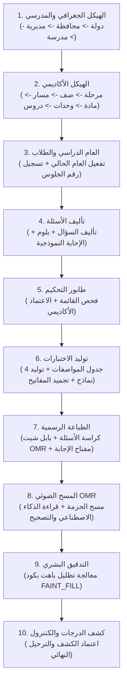

# الدليل التشغيلي: السيناريوهات المتسلسلة والرحلات الواقعية الشاملة (End-to-End Scenarios)

---

## مقدمة
الهدف من هذا الملف هو تمكين فريق الاختبار (QA) والمشغلين الجدد من رؤية وفهم واختبار النظام كمنظومة متكاملة ومترابطة، وليست مجرد شاشات منعزلة. ترشد هذه السيناريوهات الأربعة فاحص النظام خطوة بخطوة من شاشة إلى شاشة، ليرى كيف تُبنى البيانات الأساسية في البداية وتتدفق تلقائياً عبر الأنابيب الأكاديمية واللوجستية حتى تصل إلى إعلان النتائج وترحيلها.

---

## السيناريو الشامل الأول (E2E-01): الدورة الكاملة لاختبارات الشهادة العامة المدرسية
**الهدف:** إعداد منظومة مدرسية من الصفر، وتأليف الأسئلة، وتوليد اختبار وزاري رسمي بـ 4 نماذج، وطباعتها وتصحيحها آلياً بـ OMR، ومعالجة ورقة مشبوهة، وترحيل كشف الدرجات للكنترول.

### الخطوات التفصيلية للسيناريو الأول:

#### المحطة 1: بناء الهيكل الجغرافي والمدرسي
1. يدخل فاحص النظام بحساب مسؤول النظام (`System Admin`) عبر شاشة `/login`.
2. ينتقل إلى شاشة «الدول» (`/countries`)، وينقر «إضافة دولة جديدة»:
   - اسم الدولة: "الجمهورية اليمنية"، الكود: "YE".
3. ينتقل إلى شاشة «المحافظات» (`/governorates`)، وينقر «إضافة محافظة»:
   - الدولة: "الجمهورية اليمنية"، الاسم: "أمانة العاصمة"، الكود: "01".
4. ينتقل إلى شاشة «المديريات» (`/directorate`)، وينقر «إضافة مديرية»:
   - المحافظة: "أمانة العاصمة"، الاسم: "مديرية التحرير"، الكود: "0102".
5. ينتقل إلى شاشة «هيكلية المدارس» (`/organizations`)، ويوسع الشجرة حتى يصل لإدارة مديرية التحرير، وينقر «إضافة مؤسسة فرعية»:
   - المستوى: مدرسة (50)، الاسم: "ثانوية الكويت النموذجية"، الكود: "SCH-101".

#### المحطة 2: بناء الهيكل الأكاديمي والمناهج
6. ينتقل لشاشة «المراحل الدراسية» (`/educational-stages`):
   - يضيف مرحلة: "المرحلة الثانوية"، الترتيب: 2.
7. ينتقل لشاشة «الصفوف الدراسية» (`/levels`):
   - المرحلة: "المرحلة الثانوية"، اسم الصف: "الصف الثالث الثانوي"، الترتيب: 3.
8. ينتقل لشاشة «المسارات التعليمية» (`/tracks`):
   - يضيف مسار: "علمي"، الكود: "SCI".
9. ينتقل لشاشة «مسارات الصفوف» (`/class-tracks`):
   - يربط الصف "الصف الثالث الثانوي" بالمسار "علمي" (وينتج الكيان: «الثالث الثانوي - علمي»).
10. ينتقل لشاشة «المواد الدراسية» (`/subjects`):
    - يضيف مادة: "الكيمياء العامة"، كود المادة: "CHEM-301"، ويحدد خيار «مادة وزارية».
11. ينتقل لشاشة «مواد مسار الصف» (`/class-subjects`):
    - يربط مادة الكيمياء بمسار «الثالث الثانوي - علمي»، ويضبط النهاية الصغرى 50، والعظمى 100، وتضاف للمجموع.
12. ينتقل لشاشة «الوحدات الدراسية» (`/units`):
    - يضيف الوحدة: "الوحدة الأولى: الكيمياء العضوية"، الترتيب: 1.
13. ينتقل لشاشة «الدروس المدرسية» (`/lessons`):
    - يضيف الدرس: "الدرس الأول: هاليدات الألكيل"، الترتيب: 1.

#### المحطة 3: تفعيل العام الدراسي وتسجيل الممتحن
14. ينتقل لشاشة «الأعوام الدراسية» (`/academic-years`):
    - ينشئ عام: "1446هـ - 2024/2025م"، ويفعل خيار «العام الحالي» (`is_current: true`).
15. ينتقل لشاشة «سجلات الممتحنين» (`/students`):
    - يضيف طالباً جديداً:
      - المدرسة: "ثانوية الكويت النموذجية".
      - المسار: "الثالث الثانوي - علمي".
      - الاسم: "عمر خالد عبدالله الصنعاني".
      - رقم الجلوس / الرقم الأكاديمي: "705120".
      - الجنس: "ذكر".

#### المحطة 4: تأليف الأسئلة التخصصية
16. يسجل الدخول بحساب مؤلف مادة الكيمياء، ويدخل شاشة «إضافة سؤال جديد» (`/question-bank-new`):
    - يختار القطاع: مدرسي -> المرحلة الثانوية -> الثالث الثانوي - علمي -> الكيمياء -> الوحدة الأولى -> الدرس الأول.
    - نوع السؤال: اختيار من متعدد (`single_choice`).
    - نص السؤال: "ما هو الناتج الرئيسي عند تفاعل بروميد الإيثيل مع هيدروكسيد البوتاسيوم المائي؟"
    - الخيارات:
      - أ) إيثانول (ويحدد زر الراديو بجانبه كإجابة صحيحة).
      - ب) إيثين.
      - ج) إيثان.
      - د) حمض الإيثانويك.
    - التبرير العلمي: "يحدث تفاعل استبدال نيوكليوفيلي ينتج عنه كحول الإيثانول وبروميد البوتاسيوم".
    - مستوى بلوم: "تطبيق"، الصعوبة: "متوسط".
    - يضغط على زر **«إرسال للتحكيم والمراجعة»**.
    - ينتقل السؤال فوراً من `DRAFT` إلى `PENDING_REVIEW`.

#### المحطة 5: التحكيم والاعتماد في طابور المراجعة
17. يسجل الدخول بحساب المحكم الأكاديمي، ويدخل شاشة «طابور المراجعة» (`/review-queue`):
    - يجد سؤال الكيمياء في طابور الانتظار.
    - ينقر «معاينة السؤال» ويدقق الصياغة والبدائل والتبرير ومستوى بلوم.
    - ينقر «اعتماد السؤال»، وتظهر قائمة التدقيق الأكاديمي؛ يؤكد سلامة السؤال ويضغط «تأكيد الاعتماد».
    - يتحول السؤال فوراً إلى `APPROVED` ويصبح جاهزاً لبناء الاختبارات.

#### المحطة 6: بناء وتوليد نماذج الاختبار وتجميد المفاتيح
18. يسجل الدخول بحساب مدير الكنترول والامتحانات، ويدخل شاشة «توليد اختبار» (`/exams-create`):
    - **المرحلة 1:** يدخل العنوان: "امتحان الكيمياء - الدور الأول"، يختار مسار «الثالث الثانوي - علمي»، ومادة الكيمياء، ويحدد عدد النماذج: 4 نماذج، والزمن: 180 دقيقة، مع تفعيل خلط الأسئلة والخيارات.
    - **المرحلة 2:** يربط مصفوفة المعايير ويحدد عدد الأسئلة (مثلاً 50 فقرة)، ويتحقق من كفاية الرصيد؛ تظهر الشارة الخضراء باجتياز التغطية.
    - **المرحلة 3:** يستعرض لوحة القياس السيكومتري وزمن الإجابة الإجمالي، ويضغط «توليد النماذج آلياً».
    - **المرحلة 4:** يستعرض النماذج الأربعة المتولدة (أ، ب، ج، د)، ويتأكد من تكافؤ الصعوبة، ثم يضغط «اعتماد الاختبار وحفظ النماذج».
19. ينتقل تلقائياً إلى شاشة «إدارة النماذج» (`/exams-models`):
    - يراجع النماذج الأربعة ومفاتيح إجاباتها.
    - يضغط على زر **«تجميد وقفل مفاتيح الإجابة (Freeze Answer Keys)»**.
    - يولد النظام البصمة المشفرة SHA-256 للمفاتيح ويقفلها ضد أي تعديل.

#### المحطة 7: طباعة الأوراق والمخرجات الرسمية
20. من شاشة إدارة النماذج، ينقر مدير الكنترول على:
    - **«طباعة ورقة الأسئلة»** (`/exams-print-questions`): يطبع كراسة الأسئلة الرسمية للنماذج الأربعة.
    - **«طباعة أوراق التظليل»** (`/exams-print-sheets`): يطبع أوراق البابل شيت التي تحمل كود الاختبار ومواقع تظليل أرقام الجلوس والباركود.
    - **«طباعة مفتاح الإجابة»** (`/exams-print-key`): يحتفظ بنسخة مشفرة ومختومة لأعضاء الكنترول.

#### المحطة 8: المسح والتصحيح الآلي المجمع OMR
21. بعد انتهاء جلسة الامتحان الميدانية، يستلم الكنترول مظاريف أوراق الإجابة.
22. يدخل مشغل الماسحة الضوئية إلى شاشة «المسح والتصحيح الآلي» (`/omr-scanning`):
    - يختار امتحان الكيمياء.
    - يرفع حزمة الصور الممسوحة ضوئياً.
    - يعالج النظام الحزمة في ثوانٍ: يصحح ميلان الصفحات، ويقرأ الباركود ورقم الجلوس "705120"، ويحدد أنه أجاب على النموذج (أ)، ويقارن الإجابات بالمفتاح المجمد.
    - يتم تصحيح 99 ورقة بنجاح، بينما تتوقف ورقة الطالب "عمر خالد" وتُحال إلى طابور التدقيق البشري لوجود تظليل باهت في الفقرة رقم 14.

#### المحطة 9: التدقيق البشري ومعالجة الحالة المعلقة
23. يفتح المدقق البشري شاشة «المراجعة البشرية والتدقيق» (`/omr-human-review`):
    - يجد ورقة الطالب "عمر خالد" معلقة برقم الجلوس "705120".
    - يفتح عارض الورقة التفاعلي؛ يقوم العارض فورياً بتكبير الفقرة رقم 14.
    - يشاهد المدقق أن الطالب قام بتظليل الخيار (أ) بقلم رصاص خفيف لم يبلغ عتبة السواد الكاملة للكاميرا.
    - ينقر المدقق زر «تسجيل قرار المراجعة»، وتظهر قائمة الأكواد السبعة المعتمدة؛ يختار الكود:
      `FAINT_FILL` (تظليل باهت صحيح معتمد).
    - يكتب ملاحظة: "تم التحقق بالعين المجردة من نية الطالب بتظليل الخيار أ".
    - يضغط «تأكيد القرار».
    - يعيد النظام تصحيح الورقة واحتساب درجة الفقرة فورياً، وتصبح ورقة الطالب معتمدة ومكتملة بنسبة 100%.

#### المحطة 10: كشف الدرجات النهائي والترحيل للكنترول
24. يفتح رئيس لجنة الكنترول شاشة «كشف الدرجات ورصد النتائج» (`/omr-gradebook`):
    - يختار محافظة "أمانة العاصمة" -> مدرسة "ثانوية الكويت" -> مادة الكيمياء.
    - يظهر كشف الدرجات المكتمل؛ يجد الطالب "عمر خالد عبدالله الصنعاني" حاصلاً على درجة 96 من 100، بتقدير "ممتاز"، وحالة "ناجح".
    - يراجع إحصائيات اللجنة: نسبة النجاح 94.2%، والأوراق المكتملة 100%.
    - يضغط على زر **«اعتماد وترحيل الدرجات إلى الكنترول المركزي (Dispatch to Control)»**.
    - تُقفل نتائج المدرسة نهائياً، وتصدر وثيقة الكشف الرسمية بصيغة PDF موقعة ومختومة ومزودة بباركود التحقق الرقمي، وتصبح متاحة للاستعلام عبر منصة النتائج.

---

## السيناريو الشامل الثاني (E2E-02): الدورة الكاملة للاختبارات الجامعية ومواءمة نواتج التعلم (CLOs)
**الهدف:** بناء دورة اختبارات متكاملة لكلية جامعية، ومواءمة الأسئلة مع مخرجات التعلم الأكاديمية (CLOs)، وتصحيح الاختبار، واستخراج تقرير المواءمة البرامجية للاعتماد الأكاديمي.

### الخطوات التنفيذية:
1. **تهيئة الهيكل الجامعي:**
   - الدخول إلى شاشة «الكليات الجامعية» (`/colleges`) وإنشاء "كلية الحاسوب وتكنولوجيا المعلومات".
   - الدخول إلى شاشة «الأقسام الأكاديمية» (`/departments`) وإنشاء "قسم نظم المعلومات".
   - الدخول إلى شاشة «التخصصات والبرامج» (`/specializations`) وإنشاء "بكالوريوس أمن المعلومات" (4 مستويات، فصول ثنائية).
   - الدخول إلى شاشة «الأنظمة التقديرية والدرجات» (`/grading-systems`) وإنشاء "نظام الـ 100 درجة الجامعي" بنجاح من 50 وتحديد دور يونيو ودور أكتوبر.
   - الدخول إلى شاشة «المقررات الجامعية» (`/university-courses`) وإنشاء مقرر "تشفير وأمن شبكات" كود "SEC-302" بـ 3 ساعات معتمدة.
   - الدخول إلى شاشة «مقررات الفصول والتخصصات» (`/semester-subjects`) وتنزيل المقرر في المستوى الثالث - الفصل الدراسي الثاني وربطه بنظام الدرجات.
2. **تأليف الأسئلة وربط مخرجات التعلم (CLOs):**
   - يدخل أستاذ المادة ويؤلف أسئلة تشفير متقدمة في شاشة `/question-bank-new` بنمط الاختيار من متعدد والصواب والخطأ، ويربط كل سؤال برمز ناتج التعلم المستهدف (مثل: `CLO-2.1: فهم وتطبيق خوارزميات التشفير غير المتماثل RSA`).
   - تعتمد الأسئلة في شاشة طابور التحكيم `/review-queue`.
3. **توليد الاختبار الجامعي ورصد الامتحانات:**
   - يولد منسق الاختبارات في الكلية امتحاناً نهائياً بنموذجين عبر `/exams-create` ويجمد المفاتيح.
   - يتم تصحيح الأوراق عبر ماسحة الكلية OMR.
4. **استخراج تقرير الاعتماد الأكاديمي:**
   - يدخل عميد الكلية ومسؤول الجودة إلى شاشة «مصفوفة المواءمة الأكاديمية» (`/reports-alignment-matrix`).
   - يختار تخصص "أمن المعلومات" ومقرر "تشفير وأمن شبكات".
   - يعرض النظام فوراً نسبة إتقان وتحقق كل مخرج تعلم (`CLO`) لدى الطلاب من واقع أدائهم في أسئلة الامتحان، مع رسم بياني جاهز للتقديم لهيئة الاعتماد الأكاديمي.

---

## السيناريو الشامل الثالث (E2E-03): دورة المعاهد الفنية والاستيراد الضخم من إكسل
**الهدف:** استيعاب وتجهيز 500 سؤال دفعة واحدة لاختبار الدبلوم التقني الشامل عبر ملف إكسل، وفحص الأخطاء واستكمال النواقص آلياً.

### الخطوات التنفيذية:
1. **تهيئة نظام المعهد:**
   - الدخول إلى شاشة «المجالات المهنية» (`/institutes-fields`) واختيار المجال الميكانيكي.
   - الدخول إلى شاشة «أنظمة التعليم» (`/institutes-education-systems`) واختيار "دبلوم تقني سنتان" وتفعيل خيار «يخضع لاختبار وزاري شامل».
   - الدخول إلى شاشة «التخصصات المهنية» (`/institutes-specializations`) واختيار "ميكاترونكس وسيارات حديثة".
2. **الاستيراد الجماعي للأسئلة:**
   - يدخل مسؤول التدريب إلى شاشة «استيراد من إكسل» (`/question-bank-import`).
   - ينزل القالب النموذجي المعتمد، ويرفع ملفاً يضم 500 سؤال تم تجميعها من مدربي الورش.
   - يفحص النظام الملف؛ يكتشف أن 420 سؤالاً سليمة تماماً، بينما 80 سؤالاً تفتقد لتحديد الدرس ومستوى بلوم المعرفي.
   - يستورد الـ 420 سؤالاً سليمة كمسودات، ويحفظ الـ 80 سؤالاً في قائمة المعالجة.
3. **الاستكمال الجماعي للنواقص (Bulk Data Completion):**
   - ينتقل المستخدم مباشرة إلى شاشة «استكمال بيانات الأسئلة» (`/question-bulk-complete`).
   - يحدد الـ 80 سؤالاً الناقصة بمربعات الاختيار.
   - يفتح لوحة التطبيق الجماعي، ويختار لها مادة "أنظمة التحكم الإلكتروني" ومستوى بلوم "تطبيق" ومستوى صعوبة "متوسط".
   - يضغط «تطبيق التعديلات»، فتتحول كافة الأسئلة إلى أسئلة كاملة الأركان وترسل لطابور التحكيم دفعة واحدة.

---

## السيناريو الشامل الرابع (E2E-04): التحقيق الجنائي الأمني وضبط حالات الغش والتطابق
**الهدف:** اكتشاف ومحاصرة حالة غش جماعي أو تسريب موضعي داخل إحدى اللجان الامتحانية عبر خوارزميات الذكاء الاصطناعي الجنائية وسجلات الرقابة التاريخية.

### الخطوات التنفيذية:
1. **الرصد الآلي للاشتباه:**
   - أثناء معالجة أوراق إحدى اللجان في شاشة المسح OMR، يقوم محرك الكشف `_detect_cheating_or_violation` برصد مؤشر تطابق شاذ (Anomaly Score) بنسبة 98% بين ورقتي الطالبين "سالم" و"ياسر" في المقاعد المتجاورة.
2. **الفحص والمطابقة الجنائية:**
   - ينتقل رئيس الكنترول إلى شاشة «المطابقة والتحقق الهندسي وفحص الغش» (`/omr-verification`).
   - يفتح بطاقة الاشتباه؛ يعرض النظام كراستي الإجابة بجوار بعضهما، ويبرز أن الطالبين اختارا نفس الإجابة الخاطئة غير المألوفة في 12 فقرة متتالية، مع وجود علامات تظليل متطابقة هندسياً.
3. **تتبع سجل التدقيق التاريخي (Audit Trail):**
   - يدخل المحقق إلى شاشة «سجل الرقابة والتدقيق التاريخي» (`/audit-logs`).
   - يفلتر العمليات برقم كود النموذج واللجنة للتأكد من عدم وجود أي اختراق أمني أو تعديل لمفتاح الإجابة قبل جلسة الاختبار.
   - يثبت المحقق أن مفتاح الإجابة مجمد برمز SHA-256 ولم يطرأ عليه أي تغيير.
4. **القرار النظامي:**
   - يُحرر محضر ضبط اشتباه غش مدعوماً بالصور وإحداثيات التظليل وسجل التدقيق الرقمي غير القابل للتزوير، ويتم إحالة تقرير النظام إلى اللجنة العليا للامتحانات لاتخاذ العقوبات المقررة قانوناً.
