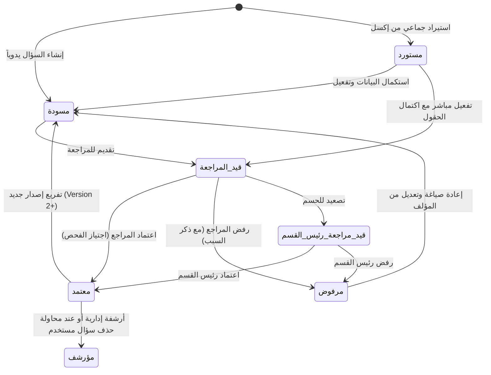

# وثيقة متطلبات النظام (System Requirements Specification)
## الباب الخامس: دورة المراجعة والاعتماد الأكاديمي وضمان الجودة

---

### 5.1 دورة حياة السؤال الأكاديمي (Question Lifecycle Workflow)

تتبع الأسئلة في النظام مسار تدقيق واعتماد متعدد المراحل لضمان الجودة العلمية واللغوية:

---

### 5.2 متطلبات طابور المراجعة الأكاديمية (`ReviewQueueView`)

#### REQ-REV-001: عرض طابور الأسئلة قيد المراجعة
يجب أن يعرض النظام للمراجع الأكاديمي قائمة بجميع الأسئلة التي تنتظر المراجعة والاعتماد في نطاق تخصصه ومواده، وتكون بحالة "قيد المراجعة" (`PENDING`) أو "قيد مراجعة رئيس القسم" (`DEPT_HEAD_REVIEW`).

#### REQ-REV-002: بطاقات إحصاءات طابور المراجعة الفورية
يجب أن يعرض النظام في ترويسة شاشة طابور المراجعة عدادات تفاعلية تحسب آلياً:
- عدد الأسئلة المعلقة بانتظار المراجعة.
- عدد الأسئلة المعتمدة في نفس النطاق.
- عدد الأسئلة المرفوضة المعاد للمؤلفين.
- إجمالي الأسئلة المنجزة.

#### REQ-REV-003: التصفية المتقدمة لطابور المراجعة
يجب أن يتيح طابور المراجعة فلترة الأسئلة المعلقة حسب: المادة، المرحلة، الصف، المسار، الوحدة، الدرس، مستوى بلوم، ومستوى الصعوبة، مع إبراز الأسئلة المصعدة بلون مميز لسرعة معالجتها.

---

### 5.3 متطلبات إجراءات التدقيق والاعتماد والرفض

#### REQ-REV-004: الاعتماد الأكاديمي الفردي للسؤال (`Approve`)
يجب أن يتيح النظام للمراجع اعتماد السؤال بضغطة زر واحدة أو بعد إتمام قائمة الفحص، وعند الاعتماد يقوم النظام بـ:
1. تغيير حالة السؤال إلى "معتمد" (`APPROVED`).
2. تسجيل هوية المراجع في حقل `reviewer` وتوثيق تاريخ ووقت الاعتماد في `approved_at`.
3. تفريغ أي سبب رفض سابق كان مدوناً في `rejectionReason`.
4. تسجيل حركة اعتماد صريحة في سجل التدقيق `AuditLog.ActionChoices.APPROVE`.

#### REQ-REV-005: الرفض الإلزامي المبرر للسؤال (`Reject`)
يجب أن يتيح النظام للمراجع رفض السؤال وإعادته للمؤلف لإعادة الصياغة، ويشترط النظام:
1. **إلزامية كتابة سبب الرفض (`rejectionReason`)**: يمنع النظام رفض أي سؤال إذا كان حقل سبب الرفض فارغاً ويعيد خطأ التحقق `400 Bad Request`.
2. نقل حالة السؤال إلى "مرفوض" (`REJECTED`).
3. توثيق هوية المراجع وتاريخ الرفض.
4. زيادة عداد مرات رفض السؤال تراكمياً (`metrics.rejection_count += 1`) في مؤشرات الجودة السيكومترية.
5. تسجيل حركة رفض في سجل التدقيق `AuditLog.ActionChoices.REJECT`.

#### REQ-REV-006: تصعيد السؤال إلى رئيس القسم الأكاديمي (`Escalate`)
يجب أن يتيح النظام للمراجع تصعيد السؤال المشكوك في دقته أو الذي يتطلب فتوى أكاديمية عليا إلى رئيس القسم، بحيث تنتقل حالته إلى "قيد مراجعة رئيس القسم" (`DEPT_HEAD_REVIEW`) مع تدوين ملاحظات الإحالة وتوثيق الحركة في سجل الرقابة.

#### REQ-REV-007: الاعتماد والرفض الجماعي (`Bulk Review`)
يجب أن يتيح النظام للمراجع تحديد عدة أسئلة في طابور المراجعة واعتمادها دفعة واحدة (`bulk-approve`)، أو رفضها دفعة واحدة مع إلزام كتابة سبب رفض موحد لجميع الأسئلة المختارة (`bulk-reject`).

---

### 5.4 متطلبات قائمة الفحص المعيارية للمراجعة (`ReviewChecklist`)

يوفر النظام نموذج فحص سباعي المعايير (`ReviewChecklist`) لتقييم السؤال قبل اتخاذ القرار النهائي:

| المعيار | الحقل المقابل | الوصف والتحقق الإلزامي |
|---|---|---|
| **سلامة اللغة والإملاء** | `linguistic_check` | خلو نص السؤال والخيارات من الأخطاء اللغوية والنحوية والإملائية |
| **الدقة العلمية والمحتوى** | `scientific_check` | صحة المعلومة ومطابقتها للمنهج المعتمد والمصادر الأكاديمية |
| **وضوح الرسوم والمرفقات** | `image_check` | جودة ووضوح الصور المرفقة وملاءمتها للمحتوى المعرفي |
| **صحة الإجابة وتوازن المشتتات** | `answer_check` | وضوح الإجابة الصحيحة وخلو المشتتات والبدائل من التداخل أو التناقض |
| **ملاءمة السؤال للمنهج والدرس** | `curriculum_check` | انتماء السؤال فعلياً للدرس والوحدة والمرحلة المقررة |
| **ملاءمة السؤال لمخرج التعلم** | `learning_outcome_check` | توافق السؤال ومخرجات التعلم الأكاديمية المستهدفة (CLO) |
| **دقة الصعوبة ومستوى بلوم** | `bloom_check` | ملاءمة تصنيف مستوى بلوم ودرجة الصعوبة للقدرات المستهدفة |

#### REQ-REV-008: التحقق التلقائي من اجتياز قائمة الفحص
يجب أن يتحقق النظام من دالة `is_all_passed()` عند تقديم قائمة الفحص؛ فإذا اجتاز السؤال جميع البنود الأساسية الستة تم اعتماده تلقائياً، وإن أخفق في أي بند وجب كتابة سبب الرفض ونقل السؤال لحالة مرفوض.

---

### 5.5 متطلبات مقارنة الإصدارات وتتبع التغييرات (`QuestionDiffView`)

#### REQ-REV-009: المقارنة البصرية للإصدارات (Visual Diff View)
يجب أن يوفر النظام واجهة مقارنة بصرية جنباً إلى جنب تعرض نص السؤال، الخيارات، الصعوبة، ومستوى بلوم بين الإصدار الجديد والإصدار السابق مع إبراز الإضافات والتعديلات والحذف بألوان مميزة.

#### REQ-REV-010: حفظ ملخص الفروقات التاريخي (Diff Summary)
يجب أن يحفظ النظام تلقائياً كائن فروقات التعديل (`diff_summary`) بصيغة JSON داخل سجل `QuestionVersion` متضمناً الحالة قبل التعديل (`before`) وبعد التعديل (`after`) وتحديد من قام بالتغيير وسببه.
