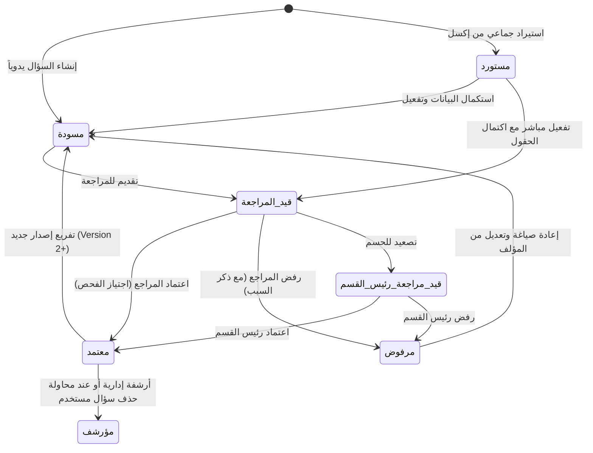

# وثيقة متطلبات النظام الرسمية (System Requirements Specification - SRS)
## نظام بنك الأسئلة المركزي، التوليد، والتصحيح الآلي المتقدم (NewQuestionBank)
### الإصدار: 4.0 الإنتاجي (Production Baseline)
### المرجع الأساسي لفريق ضبط الجودة والاختبار (QA & Testing Reference)

---

## 📌 ديباجة وتوجيهات لفريق الاختبار (QA & Testing Guide)
1. **المرجعية الصارمة**: هذه الوثيقة تم استخراجها والتحقق منها مباشرة من الكود البرمجي الفعلي للنظام (Frontend & Backend Models, Views, Serializers, Workflows, APIs, Permissions, and Validations).
2. **صيغة الاختبار والتحقق**: كل متطلب في هذه الوثيقة مصاغ بإحدى الصيغ الثلاث الإلزامية:
   - `يجب أن يتيح النظام...` (Functional Capability to Test).
   - `يجب أن يمنع النظام...` (Negative Constraint / Security Boundary to Test).
   - `يجب أن يتحقق النظام من...` (Validation Rule / Business Integrity to Test).
3. **معرفات المتطلبات الفريدة**: كل متطلب يحمل معرّفاً ثابتاً وفريداً يسهل الربط به في تقارير الاختبار (مثل `REQ-SYS-...`, `REQ-ROLE-...`, `REQ-AUTH-...`, `REQ-QB-...`, `REQ-REV-...`, `REQ-EXAM-...`, `REQ-DISP-...`, `REQ-OMR-...`, `REQ-RPT-...`, `REQ-AUD-...`, `REQ-NFR-...`).

---

## 📑 فهرس محتويات الوثيقة الشاملة
1. [الباب الأول: مقدمة النظام، الهيكل العام، والمصطلحات الديناميكية](01_introduction_and_system_architecture.md)
2. [الباب الثاني: المستخدمون، الأدوار، المصادقة، والتحكم بالوصول](02_users_roles_and_access_control.md)
3. [الباب الثالث: الهيكل الجغرافي والمؤسسي، والترتيب الأكاديمي للقطاعات الثلاثة](03_common_and_academic_hierarchy.md)
4. [الباب الرابع: بنك الأسئلة المركزي، محرك التأليف، والاستيراد الجماعي](04_question_bank_and_authoring.md)
5. [الباب الخامس: مسار المراجعة والتحكيم الأكاديمي، فحص الجودة، وتتبع الإصدارات](05_review_workflow_and_quality.md)
6. [الباب السادس: جدول المواصفات، بناء وتوليد الاختبارات، النماذج، وسجلات الممتحنين](06_exam_generation_tos_and_models.md)
7. [الباب السابع: نظام توزيع وتصدير الاختبارات المجدول وحماية التسريب](07_exam_distribution_and_dispatch.md)
8. [الباب الثامن: نظام التصحيح الآلي (OMR)، قوالب التظليل، والتدقيق البشري](08_omr_scanning_and_evaluation.md)
9. [الباب التاسع: التقارير، التحليلات الأكاديمية، ومحرك القياس السيكومتري](09_reports_analytics_and_psychometrics.md)
10. [الباب العاشر: سجلات التدقيق الجنائي، الرقابة، وإدارة السجلات](10_audit_logs_and_security.md)
11. [الباب الحادي عشر: مصفوفة العلاقات، دورات الحياة، الملفات، والإشعارات، والمتطلبات غير الوظيفية](11_cross_cutting_and_non_functional.md)

---


================================================================================

# وثيقة متطلبات النظام (System Requirements Specification)
## الباب الأول: مقدمة النظام، الهيكلية المعمارية، ونطاق التطبيق

---

### 1.1 مقدمة النظام (System Overview)
نظام **بنك الأسئلة والاختبارات والتصحيح الآلي (Question Bank, Exam Generation & OMR System)** هو منصة مؤسسية موحدة متكاملة، مصممة لإدارة الدورة الكاملة لعمليات القياس والتقويم التعليمي والأكاديمي. يغطي النظام احتياجات المؤسسات التعليمية بمختلف مستوياتها:
1. **التعليم المدرسي (Schools)**: التعليم الأساسي والثانوي بمساراته وتخصصاته.
2. **التعليم الجامعي (Universities)**: الكليات والأقسام والبرامج والتخصصات الأكاديمية بنظام الساعات والمقررات.
3. **التعليم الفني والتدريب المهني (Institutes)**: المعاهد الفنية والمهنية بمجالاتها ونظمها التدريبية.

يرتكز النظام على التكامل الوثيق بين أربعة محركات رئيسية:
- **المستودع الإلكتروني المركزي لبنك الأسئلة**: لتأليف وتصنيف وحفظ ومراجعة واعتماد الأسئلة وفق تصنيف بلوم للأهداف المعرفية ومخرجات التعلم الأكاديمية.
- **محرك بناء وتوليد الاختبارات المعياري**: لسحب الأسئلة آلياً أو يدوياً بالاعتماد على جدول المواصفات (TOS)، وبناء نماذج امتحانية متعددة ومتكافئة مع خلط ترتيب الأسئلة والخيارات وتجميد مفاتيح الإجابة المشفرة.
- **نظام توزيع وتصدير الاختبارات المجدول**: لإرسال حزم الاختبارات المعتمدة ونماذجها إلى المدارس والجامعات المستقلة مع آليات تشفير وجدولة زمنية تمنع التسريب.
- **محرك التصحيح الآلي الضوئي (OMR)**: لقراءة ومسح أوراق الإجابة (Bubble Sheets) واستخراج البيانات عبر خط معالجة هجين (OpenCV ومصفوفة القرار وتدقيق الذكاء الاصطناعي)، مع واجهة مراجعة بشرية للتدقيق وحل الاستثناءات، واحتساب الدرجات، والتحليل السيكومتري (معامل الصعوبة، معامل التمييز، وتحليل المشتتات، ومعامل ثبات الاختبار KR-20).

---

### 1.2 البنية المعمارية ومكونات النظام (Architecture & Stacks)
يتكون النظام من:
1. **الواجهة الخلفية (Backend API)**:
   - إطار العمل: `Django 5.x` و `Django REST Framework (DRF)`.
   - إدارة الاتصالات الفورية: `Daphne ASGI Server` و `Django Channels` لـ WebSockets.
   - النواة المشتركة للمنظومة: وحدات إدارة الصلاحيات، المستخدمين، الشاشات، المؤسسات، التزامن، والتدقيق الرقابي.
   - قواعد البيانات: `PostgreSQL 16+` مع التوافقية الكاملة لنظام الحذف المنطقي (`SoftDeleteModel`).
   - توثيق الواجهات البرمجية: `drf-spectacular` و `drf-yasg` (Swagger / OpenAPI).
2. **الواجهة الأمامية (Frontend SPA)**:
   - إطار العمل: `Vue.js 3` (Composition API) مع `Vite`.
   - مكتبة التصميم وواجهة المستخدم: `Vuetify 3` مع دعم كامل للاتجاه من اليمين إلى اليسار (`RTL`) واللغة العربية.
   - إدارة الحالة: `Pinia` و Vue Reactive Stores (`dataStore`, `notificationStore`, `state.js`).
   - مسار التصفح: `vue-router` مع حماية المسارات وفحص الصلاحيات وربط الشاشات الديناميكية.
3. **التكامل الخارجي والبوابة (Portal & Integrations)**:
   - المصادقة الموحدة: `Keycloak SSO` ودعم تسجيل الدخول عبر البوابة.
   - التزامن مع الأنظمة الخارجية: دعم المزامنة الهجينة (Pull/Push) مع أنظمة إدارة المدارس (SMS)، أنظمة الجامعات (UMS)، نظام الكنترول المركزي (Control)، وتخطيط موارد المؤسسة (ERP).

---

### 1.3 نطاق المصطلحات المتكيفة (Dynamic Academic Terminology)
يتكيف النظام تلقائياً على مستوى الواجهات والنماذج بناءً على نوع المؤسسة الأكاديمية المستهدفة (`useTerminology.js`):

| المفهوم العام | سياق التعليم المدرسي (`school`) | سياق التعليم الجامعي (`university`) | سياق المعاهد المهنية (`institute`) |
|---|---|---|---|
| المستوى التنظيمي الأول | المرحلة الدراسية (`SchoolStage`) | الكلية (`UniversityCollege`) | المجال المهني / التقني (`InstituteField`) |
| المستوى التنظيمي الثاني | الصف الدراسي (`SchoolLevel`) | القسم الأكاديمي (`UniversityDepartment`) | نظام التعليم والتدريب (`InstituteEducationSystem`) |
| المستوى التنظيمي الثالث | المسار الدراسي (`SchoolTrack`) | التخصص الأكاديمي (`UniversitySpecialization`) | التخصص المهني (`InstituteSpecialization`) |
| الوحدة التعليمية الكبرى | المادة الدراسية (`SchoolSubject`) | المقرر الأكاديمي (`UniversityCourse`) | المادة التدريبية (`InstituteSubject`) |
| التقسيم المرحلي الزمني | العام الدراسي / الفصل (`AcademicYear`) | المستوى والفصل الجامعي (`Semester`) | المستوى والفترة الدراسية (`InstituteSemester`) |
| الحزمة المنهجية | مسار مادة الصف (`SchoolClassSubject`) | مقرر الفصل والتخصص (`SemesterSubject`) | مقرر الخطة التدريبية (`CurriculumSubject`) |
| التقسيم الداخلي للمحتوى | الوحدة الدراسية (`SchoolUnit`) | الموضوع الأكاديمي (`UniversityUnit`) | الوحدة التدريبية |
| الحصة / المحاضرة | الدرس (`SchoolLesson`) | المحاضرة (`UniversityLesson`) | الجلسة التدريبية |
| ناتج التعلم المستهدف | مخرج التعلم (`LearningOutcome`) | ناتج التعلم للمقرر (`CLO`) | الجدارة المهنية |
| القائم بالتأليف | المعلم / مؤلف الأسئلة | عضو هيئة التدريس | المدرب الأكاديمي / المهني |
| الاختبار | الامتحان المدرسي | الاختبار الجامعي | التقييم المهني |

---

### 1.4 متطلبات الهيكل المعماري والتهيئة العامة

#### REQ-SYS-001: نطاق الدعم المؤسسي المتعدد
يجب أن يدعم النظام العمل بنمط المؤسسات المتعددة أو المؤسسة الموحدة وفق إعدادات التهيئة المركزية (`settings.multiple_company`).

#### REQ-SYS-002: دعم المسارات الأكاديمية الثلاثية
يجب أن يوفر النظام واجهات ونماذج وقواعد معالجة مستقلة ومتكاملة للمسارات الأكاديمية الثلاثة:
1. قطاع التعليم المدرسي العام.
2. قطاع التعليم الجامعي والأكاديمي.
3. قطاع المعاهد والتعليم الفني والتدريب المهني.

#### REQ-SYS-003: دعم اللغة العربية والاتجاه من اليمين لليسار (RTL)
يجب أن تكون جميع شاشات النظام، رسائل التحقق، جداول البيانات، الرسوم البيانية، ونماذج الطباعة باللغة العربية مع دعم الاتجاه RTL بصورة افتراضية، مع حفظ المقابل الإنجليزي للحقول الأساسية (`name_ar` إلزامي، `name_en` اختياري).

#### REQ-SYS-004: التوافقية مع محركات العرض العلمي والرياضي
يجب أن يدعم النظام محرر النصوص الغني ومحرك العرض العلمي (LaTeX / KaTeX) لعرض وتحرير المعادلات الرياضية والكيميائية والفيزيائية والرموز المعقدة داخل نصوص الأسئلة والخيارات والتقارير.

#### REQ-SYS-005: الحفظ والتراجع الآمن (Soft Delete & Atomic Transactions)
يجب أن تطبق جميع نماذج النظام الحذف المنطقي (`SoftDeleteModel`)، بحيث لا يتم حذف السجلات فعلياً من قاعدة البيانات عند الحذف، بل تُعلم بالحقل `is_deleted=True` مع تسجيل توقيت الحذف `deleted_at`، مع تنفيذ كافة العمليات المترابطة أو الجماعية داخل معاملات ذرية (`transaction.atomic`) لضمان تكامل البيانات وعدم تجزؤها في حال حدوث أي خطأ.


================================================================================

# وثيقة متطلبات النظام (System Requirements Specification)
## الباب الثاني: المستخدمون، الأدوار، المصادقة، والصلاحيات

---

### 2.1 المستخدمون والأدوار المؤسسية (Users & Roles)

#### 2.1.1 المستويات الإدارية الهرمية للمؤسسة (`CompanyLevel`)
يحدد الحقل `company_level` النطاق الإداري والصلاحية المكانية للمستخدم والمجموعة والشاشة في المنظومة استناداً إلى مستويات التنظيم الإداري:

| الرمز الرقمي | المستوى الإداري | المسمى الوظيفي | حقل الشاشة المقابل | القيود والحقول الإلزامية في الهيكل |
|---|---|---|---|---|
| **10** | `ADMIN` | مدير النظام العام | `for_admin` | يمتلك كامل الصلاحيات المركزية على كافة الشاشات والبيانات |
| **20** | `MINISTRY` | ديوان الوزارة | `for_ministry` | يلزم تحديد الدولة (`fk_country`)؛ إشراف شامل على مستوى الدولة |
| **30** | `GOVERNORATE` | مكتب المحافظة | `for_governorate` | يلزم تحديد المحافظة (`fk_governorate`)؛ مقيد بنطاق المحافظة الجغرافي |
| **40** | `DIRECTORATE` | المديرية التعليمية | `for_directorate` | يلزم تحديد المديرية (`fk_directorate`)؛ مقيد بمدارس الكيان الجغرافي |
| **50** | `COMPANY` | المنشأة التعليمية (مدرسة / معهد / جامعة) | `for_company` | مقيد بالمنشأة التعليمية المستقلة وفروعها |
| **60** | `COLLEGE` | الكلية الجامعية / الفرع الأكاديمي | `for_college` | مقيد بالكلية أو الفرع الأكاديمي الداخلي التابع للمنشأة |

#### 2.1.2 الأدوار الوظيفية لنظام بنك الأسئلة والامتحانات (Functional Roles)
1. **مدير النظام العام (System Administrator)**:
   - الوظيفة: إدارة إعدادات المنصة، المستخدمين، مجموعات الصلاحيات، مزامنة الشاشات، وسجلات التدقيق.
   - النطاق: جميع وحدات وشاشات النظام دون قيود.
2. **المسؤول الأكاديمي الوزاري (Ministry Academic Officer)**:
   - الوظيفة: اعتماد الخطط والمناهج، إقرار جداول المواصفات المركزية، وتوزيع الاختبارات الوزارية المجدولة.
   - النطاق: التهيئة الأكاديمية، بنك الأسئلة، الاختبارات، والتوزيع على مستوى الوزارة والمحافظات.
3. **رئيس القسم الأكاديمي / الموجه الأول (Department Head / Senior Inspector)**:
   - الوظيفة: مراجعة الأسئلة المصعدة، الاعتماد النهائي للأسئلة في التخصص، وتدقيق مصفوفات مواءمة نواتج التعلم.
   - النطاق: طابور المراجعة في تخصصه، بنك الأسئلة، وجداول المواصفات.
4. **مؤلف الأسئلة (Question Author / Faculty)**:
   - الوظيفة: إنشاء وإدخال وتعديل الأسئلة (يدوياً، سريعاً، أو بالاستيراد)، وربطها بنواتج التعلم والمستويات المعرفية، وتقديمها للمراجعة.
   - النطاق: بنك الأسئلة، شاشة السؤال الجديد، الإدخال السريع، استيراد إكسل، واستكمال الأسئلة.
5. **المراجع الأكاديمي (Academic Reviewer)**:
   - الوظيفة: فحص الأسئلة المرفوعة وفق قائمة التدقيق المعيارية، إقرار اعتمادها أو رفضها مع تدوين الملاحظات.
   - النطاق: طابور المراجعة، شاشة مقارنة الإصدارات (Diff View)، وسجل مراجعة الأسئلة.
6. **مسؤول الامتحانات والكنترول (Exam & Control Officer)**:
   - الوظيفة: بناء الاختبارات آلياً ويدوياً، إدارة النماذج، تجميد مفاتيح الإجابة المشفرة، وتسجيل الممتحنين.
   - النطاق: توليد الاختبارات، جداول المواصفات، المحذوفات، النماذج، والأرشيف.
7. **مشرف الطباعة والتوزيع السري (Printing & Dispatch Officer)**:
   - الوظيفة: متابعة مهام توزيع الاختبارات، حزم التصدير المشفرة، وأوامر طباعة أوراق الأسئلة وأوراق التظليل.
   - النطاق: شاشة التوزيع، وسجل أوامر الطباعة المركزية.
8. **مشغل الماسح الضوئي ومصمم القوالب (OMR Operator & Designer)**:
   - الوظيفة: تصميم قوالب التظليل، إجراء عمليات المسح الضوئي المجمعة، وفحص جودة القراءة في مختبر الماسح.
   - النطاق: لوحة OMR، مصمم القوالب، المسح الضوئي، ومختبر الماسح.
9. **مدقق ومراجع أوراق OMR (OMR Human Reviewer)**:
   - الوظيفة: فحص الأوراق الملتبسة، تدقيق التظليل المشطوب أو المزدوج، وتعديل الخيارات وفق أكواد أسباب معتمدة.
   - النطاق: شاشة التدقيق البشري، عارض أوراق الإجابة، وسجل تدقيق OMR.
10. **محلل القياس والتقويم (Psychometrician & Analyst)**:
    - الوظيفة: استعراض مؤشرات صعوبة وتمييز الأسئلة، فحص ثبات الاختبارات، ومتابعة تقارير العدالة الإقليمية وتغطية المناهج.
    - النطاق: كافة تقارير بنك الأسئلة والقياس السيكومتري.
   - النطاق: توليد الاختبارات، جداول المواصفات، النماذج، المحذوفات، وسجلات الممتحنين.
7. **مسؤول الطباعة السرية (Confidential Printing Officer)**:
   - الوظيفة: استلام أوامر طباعة الاختبارات المعتمدة، طباعة كراسات الأسئلة، ومفاتيح الإجابة، وأوراق الإجابة المقروءة آلياً (OMR Bubble Sheets).
   - النطاق: سجل أوامر الطباعة، طباعة كراسات الأسئلة، طباعة مفاتيح التصحيح، وطباعة بابل شيت.
8. **مشغل ومراجع التصحيح الآلي (OMR Operator & Verifier)**:
   - الوظيفة: رفع دفعات صور أوراق الإجابة، تشغيل محرك القراءة والمعالجة الآلية، فحص الحالات الملتبسة وتعديلها يدوياً مع تدوين السبب المعتمد، وتصدير كشوف الدرجات.
   - النطاق: لوحة تحكم OMR، المسح والتصحيح، المراجعة والتدقيق البشري، مصمم القوالب، وكشف الدرجات والرصد.

---

### 2.2 متطلبات الأدوار (Role Requirements)

#### REQ-ROLE-001: تقييد الوصول حسب المستوى الإداري
يجب أن يمنع النظام أي مستخدم من الوصول إلى بيانات أو شاشات تقع خارج مستواه الإداري المحدد (`company_level`).

#### REQ-ROLE-002: تقييد صلاحيات مؤلف الأسئلة
يجب أن يقصر النظام صلاحية مؤلف السؤال على إنشاء وتعديل الأسئلة الخاصة به فقط طالما كانت بحالة مسودة أو مستورد أو مرفوض، ويجب أن يمنعه من تعديل أو اعتماد أي سؤال بمجرد انتقاله إلى حالة "قيد المراجعة" أو "معتمد".

#### REQ-ROLE-003: حصر صلاحية الاعتماد والرفض على المراجعين
يجب أن يتيح النظام إجراءات الاعتماد (`Approve`)، الرفض (`Reject`)، والتصعيد لرئيس القسم (`Escalate`) للمستخدمين المخولين بصلاحية المراجعة الأكاديمية فقط، مع منع المؤلف من مراجعة أو اعتماد الأسئلة التي قام بتأليفها بنفسه.

#### REQ-ROLE-004: تقييد تجميد مفتاح الإجابة واعتماد الاختبارات
يجب أن يحصر النظام صلاحية اعتماد الاختبار وتجميد مفتاح الإجابة التشفيري (`freeze_key`) على مسؤولي الكنترول والامتحانات المخولين فقط.

#### REQ-ROLE-005: تدقيق التعديل اليدوي لنتائج التصحيح الضوئي
يجب أن يتيح النظام تعديل الإجابات المستخرجة آلياً في شاشة المراجعة البشرية للمراجعين المخولين فقط، مع إلزامهم بتحديد كود سبب التعديل وتوثيق هويتهم وعنوان IP في سجل تدقيق مراجعة OMR.

---

### 2.3 متطلبات المصادقة، الجلسات، وحماية الواجهات (Authentication & Security)

#### REQ-AUTH-001: تسجيل الدخول بالمصادقة المزدوجة (JWT Credentials)
يجب أن يوفر النظام تسجيل الدخول عبر الواجهة البرمجية بإرسال اسم المستخدم وكلمة المرور المشفرة مع رمز التحقق البصري (`Captcha`)، وإعادة رمز الدخول (`access_token`) ورمز التجديد (`refresh_token`) وبيانات ملف المستخدم والمؤسسة والمستوى.

#### REQ-AUTH-002: دعم الدخول الموحد للمنصة (Keycloak Single Sign-On - SSO)
يجب أن يدعم النظام الدخول الموحد مع منصة الوزارة التعليمية عبر بروتوكول OpenID Connect / Keycloak عبر المسارات:
- `/sso-login`: بدء جلسة المصادقة الموحدة وإعادة التوجيه إلى مزود الهوية.
- `/sso/callback` و `/auth/callback`: استقبال ومعالجة رمز التحقق وتبادل التوكن.
- `/auth/error`: معالجة وعرض أخطاء المصادقة للمستخدم.
- `/logout-success`: إتمام تسجيل الخروج الموحد من جميع الأنظمة المرتبطة.

#### REQ-AUTH-003: إدارة وتجديد رموز الجلسة (Sliding JWT Refresh)
يجب أن يدعم النظام تجديد رمز الوصول المنتهي تلقائياً عبر نقطة النهاية `/auth/token/refresh/` باستخدام الـ `refresh_token`، مع إدراج الرمز القديم فوراً في القائمة السوداء (`token_blacklist`) لمنع إعادة استخدامه.

#### REQ-AUTH-004: إنهاء الجلسة وتسجيل الخروج الآمن
يجب أن يتيح النظام للمستخدم تسجيل الخروج في أي وقت، مع قيام الواجهة بحذف التوكنات المخزنة محلياً، وإرسال طلب إبطال التوكن إلى الخادم، وتوجيه المستخدم لشاشة الدخول.

#### REQ-AUTH-005: إدارة وتغيير كلمة المرور
يجب أن يتيح النظام للمستخدم المسجل تغيير كلمة المرور الخاصة به عبر شاشة `ChangePassword.vue`، ويشترط النظام:
1. إدخال كلمة المرور الحالية والتحقق من صحتها في الخادم.
2. ألا تقل كلمة المرور الجديدة عن 8 خانات وتحتوي على مزيج آمن (أحرف، أرقام، رموز).
3. تطابق كلمة المرور الجديدة مع حقل تأكيد كلمة المرور.

#### REQ-AUTH-006: حماية مستودعات الوسائط والملفات الحساسة (Gate 7 Protected Media)
يجب أن يمنع النظام بشكل صارم (`protected_media_view`) الوصول المجهول (Anonymous Access) إلى الملفات المخزنة في مسارات وسائط الامتحانات الحساسة:
- أوراق إجابة الطلاب الممسوحة ضوئياً (`uploads/original/`).
- الصور المعالجة والمحاذاة هندسياً (`uploads/aligned/`).
- صور صفحات كراسات الإجابة (`pages/`).
ويجب ألا يُسمح بتحميل أو عرض هذه الملفات إلا في الحالات التالية:
1. أن يكون الطلب صادراً من مستخدم مسجل يمتلك جلسة مصادقة نشطة.
2. أن يحمل الطلب رمز JWT صالحاً ومحققا في ترويسة الطلب (`Authorization: Bearer <token>`) أو كمعامل استعلام (`?token=<token>`).
3. أن يكون مصدر الطلب (`Referer` أو `Origin`) أو عنوان IP محلياً وموثوقاً مصرحاً له.
وعند انتفاء هذه الشروط يجب أن يعيد الخادم رمز الاستجابة `403 Forbidden`.

---

### 2.4 متطلبات مصفوفة الصلاحيات وإدارة الشاشات (Permissions & Screen Engine)

#### REQ-PERM-001: مصفوفة العمليات التشغيلية (Operation Types)
يجب أن يربط النظام صلاحيات الوصول للشاشات والوظائف بـ 16 عملية قياسية استناداً إلى `OperationTypeChoices`:
1. `VIEW_SCREEN (1)`: عرض الشاشة والقوائم.
2. `ADD_SCREEN (2)`: إضافة وسجلات جديدة.
3. `EDIT_SCREEN (3)`: تعديل السجلات.
4. `DETAIL_SCREEN (4)`: عرض التفاصيل والحذف المنطقي.
5. `FORCE_DETAIL_SCREEN (5)`: الحذف النهائي الإجباري.
6. `EXPORT_SCREEN (6)`: تصدير البيانات إلى Excel/PDF/CSV.
7. `IMPORT_SCREEN (7)`: استيراد البيانات من الملفات الخارجية.
8. `VIEW_DELETED (8)`: استعراض السجلات المحذوفة منطقياً.
9. `RESTORE_SCREEN (9)`: استعادة السجلات المحذوفة.
10. `SELECT_SCREEN (10)`: جلب القوائم المنسدلة والخيارات المرجعية.
11. `LOG (11)`: استعراض سجل التدقيق للكيان.
12. `PRINT (12)`: طباعة التقارير والكراسات.
13. `SYNC_PULL (13)`: سحب المزامنة من نظام خارجي.
14. `SYNC_PUSH (14)`: دفع وتصدير المزامنة إلى نظام خارجي.
15. `SAVE_PRINT_REPORT_SETTING (15)`: حفظ قوالب وتفضيلات الطباعة.
16. `DELETE_PRINT_REPORT_SETTING (16)`: حذف إعدادات الطباعة المحفوظة.

#### REQ-PERM-002: خريطة مطابقة العمليات بالواجهات الخلفية
يجب أن تطابق الواجهة الخلفية تلقائياً بين أفعال ومناهج HTTP وصلاحيات العمليات عبر مصفوفة `ACTION_OPERATION_MAP` و `METHOD_OPERATION_MAP`، بحيث يتم فحص صلاحية `OperationType` قبل تنفيذ دالة العرض (`ViewSet Action`).

#### REQ-PERM-003: حجب الشاشات والعناصر غير المصرح بها في الواجهة الأمامية
يجب أن تتحقق الواجهة الأمامية عبر مكون فحص الصلاحيات وخدمة القوائم من صلاحية المستخدم الحالية، وتقوم بإخفاء الأزرار والروابط والحقول وعناصر القائمة الجانبية التي لا يمتلك المستخدم إذناً صريحاً لتشغيلها.


================================================================================

# وثيقة متطلبات النظام (System Requirements Specification)
## الباب الثالث: التهيئة الأكاديمية، الهيكل الجغرافي، والمؤسسات التعليمية

---

### 3.1 الهيكل الجغرافي والإقليمي (Geographical Hierarchy)

يتكون الهيكل الجغرافي من أربعة مستويات هرمية مترابطة تحدد التوزيع المكاني للمؤسسات والطلاب والاختبارات الموزعة:
1. **الدول (`Country`)**:
   - الحقول: `name_ar` (إلزامي)، `name_en`، `nationality_name_en`، `code` (كود الدولة).
2. **المحافظات (`Governorate`)**:
   - الحقول: `fk_country` (ربط بالدولة)، `name_ar` (إلزامي)، `name_en`، `code`، `is_remote_area` (تحديد ما إذا كانت المحافظة منطقة نائية لحسابات العدالة التعليمية ومعامل الصعوبة)، `difficulty_modifier` (معامل تعديل صعوبة الاختبار للمناطق النائية).
3. **المديريات (`Directorate`)**:
   - الحقول: `fk_governorate` (ربط بالمحافظة)، `name_ar` (إلزامي)، `name_en`، `code`.
4. **المناطق والعُزل (`Region`)**:
   - الحقول: `fk_directorate` (ربط بالمديرية)، `name_ar` (إلزامي)، `name_en`، `code`.

#### REQ-GEO-001: إدارة الهيكل الجغرافي
يجب أن يتيح النظام للمستخدم المخول عمليات الإضافة والعرض والتعديل والحذف المنطقي للدول والمحافظات والمديريات والمناطق، مع تطبيق شروط الربط المتسلسل (بحيث تتبع كل عزلة لمديرية، وكل مديرية لمحافظة، وكل محافظة لدولة).

#### REQ-GEO-002: دعم تصنيف المناطق النائية
يجب أن يتيح النظام لمدير النظام تحديد المحافظات المصنفة كـ "مناطق نائية" (`is_remote_area=True`) وتحديد معامل صعوبة مكافئ لها لاستخدامه في تقارير العدالة الأكاديمية الإقليمية.

---

### 3.2 هيكلية المؤسسات التعليمية (`OrganizationTree`)

نموذج المنشأة المركزية (`Organization`) يمثل الكيان الإداري أو التعليمي (وزارة، مكتب محافظة، إدارة مديرية، مدرسة، كلية، معهد).

#### الحقول والخصائص:
- `company_level`: المستوى الإداري للمنشأة (`10=Admin`, `20=Ministry`, `30=Governorate`, `40=Directorate`, `50=School/University/Institute`, `60=College/Branch`).
- `fk_parent_organization`: المنشأة الإدارية الأعلى المشرفة في الشجرة الهرمية.
- `fk_country`, `fk_governorate`, `fk_directorate`, `fk_region`: النطاق الجغرافي للمنشأة.
- `name_ar`: اسم المنشأة بالعربية (إلزامي).
- `name_en`: اسم المنشأة بالإنجليزية.
- `branch_no`: رقم الفرع أو الرقم التعريفي للمنشأة (يستخدم كمعرف للمدارس في استلام وتأكيد حزم الاختبارات).
- `is_active`: حالة التفعيل.

#### REQ-ORG-001: البنية الشجرية للمؤسسات التعليمية
يجب أن يتيح النظام بناء شجرة مؤسسية هرمية تبدأ من الوزارة في القمة، تليها مكاتب المحافظات، ثم المديريات، ثم المدارس أو الجامعات التابعة، لضمان سريان التوجيهات وحزم الاختبارات والتقارير عبر السلسلة الإدارية المعتمدة.

---

### 3.3 التهيئة العامة المشتركة (Common Academic Setup)

#### 3.3.1 الأعوام الدراسية (`AcademicYear`)
- الحقول: `hijri_year` (السنة الهجرية)، `gregorian_year` (السنة الميلادية)، `is_current` (السنة الحالية النشطة)، `is_active` (مفعل).
- القيود والتحقق:
  - قيد تفرد على `hijri_year` للسجلات النشطة غير المحذوفة (`unique_academic_year_hijri_no_deleted`).
  - قيد تفرد على `gregorian_year` للسجلات النشطة غير المحذوفة (`unique_academic_year_gregorian_no_deleted`).
  - قاعدة عمل: يمنع النظام إلغاء تفعيل أو إزالة علامة "السنة الحالية" من العام الدراسي الحالي إذا لم يكن هناك عام دراسي آخر محدد كسنة حالية بديلة.

#### 3.3.2 سجلات الطلاب والممتحنين (`Student`)
- الحقول: `academic_number` (الرقم الأكاديمي/رقم القيد - فريد وإلزامي)، `student_id` (الرقم الوطني)، `name_ar` (إلزامي)، `name_en`، `gender` (1: ذكر، 2: أنثى)، `birthdate`، `birth_place`، `address`، `phone_number`، `home_number`، `parent_name`، `parent_relation`، `student_image`، `registration_form`، `organization` (المنشأة التعليمية)، `country`، `directorate`، `is_active`.
- الارتباط: يرتبط نموذج `Student` بحساب مستخدم نظام (`User`) اختيارياً، ويرتبط بتسجيلات نماذج الامتحانات (`StudentExamRegistration`).

#### 3.3.3 نواتج ومخرجات التعلم العامة (`LearningOutcome`)
- الحقول: `code` (كود مخرج التعلم)، `title` (العنوان)، `description` (الوصف)، `bloom_level` (مستوى بلوم المقابل)، `subject`، `unit`، `lesson`، `is_active`.

#### REQ-COM-001: إدارة الأعوام الدراسية وتعيين العام الحالي
يجب أن يتيح النظام للمستخدم المخول إضافة وتعديل الأعوام الدراسية مع التحقق الصارم من عدم تكرار السنة الهجرية أو الميلادية، وضمان وجود عام دراسي واحد على الأقل محدد كـ "عام حالي" نشط في النظام طوال الوقت.

#### REQ-COM-002: إدارة ملفات الطلاب وسجلات القيد
يجب أن يتيح النظام تسجيل وتعديل بيانات الطلاب مع إلزامية إدخال الرقم الأكاديمي الموحد والاسم العربي والجنس والمؤسسة، مع دعم رفع الصورة الشخصية ونموذج التسجيل الورقي كملف مرفق.

---

### 3.4 تهيئة قطاع المدارس (Schools Setup)

تتألف الهيكلية الأكاديمية للمدارس من النماذج التالية:
1. **المراحل الدراسية (`SchoolStage`)**:
   - الحقول: `name_ar` (إلزامي)، `name_en`، `order` (ترتيب المرحلة)، `is_active`.
2. **الصفوف الدراسية (`SchoolLevel`)**:
   - الحقول: `stage` (المرحلة التابع لها - إلزامي)، `name_ar` (إلزامي)، `name_en`، `order`، `is_active`.
3. **المسارات التعليمية (`SchoolTrack`)**:
   - الحقول: `name_ar` (إلزامي مثل: عام، علمي، أدبي)، `name_en`، `code` (كود المسار - إلزامي)، `note`، `is_active`.
4. **مسارات الصفوف (`SchoolClassTrack`)**:
   - الحقول: `level` (الصف الدراسي - إلزامي)، `track` (المسار التعليمي - إلزامي)، `is_default` (مسار افتراضي للصف)، `note`، `is_active`.
5. **المواد الدراسية المدرسية (`SchoolSubject`)**:
   - الحقول: `name_ar` (إلزامي)، `name_en`، `subject_code` (كود المادة الوزاري)، `subject_order`، `is_ministerial` (مادة وزارية خاضعة للامتحانات العامة)، `note`، `is_active`.
6. **مواد مسار الصف (`SchoolClassSubject`)**:
   - الحقول: `class_track` (مسار الصف - إلزامي)، `school_subject` (المادة المدرسية - إلزامي)، `min_score` (الدرجة الصغرى للنجاح)، `max_score` (الدرجة الكبرى)، `added_to_total` (هل تضاف للمجموع العام)، `optional` (مادة اختيارية)، `note`، `is_active`.
7. **الشُعب والفصول المدرسية (`SchoolSection`)**:
   - الحقول: `organization` (المدرسة التابعة - إلزامي)، `class_track` (مسار الصف)، `academic_year` (العام الدراسي)، `name_ar` (إلزامي مثل "أول/1")، `name_en`، `section_code`، `gender` (بنين / بنات / مشترك)، `max_capacity` (السعة الاستيعابية)، `is_active`.
8. **الوحدات الدراسية المدرسية (`SchoolUnit`)**:
   - الحقول: `class_subject` (مادة مسار الصف)، `school_subject`، `name_ar` (إلزامي)، `name_en`، `order`، `is_active`.
9. **الدروس المدرسية (`SchoolLesson`)**:
   - الحقول: `subject` (المادة المدرسية - إلزامي)، `unit` (الوحدة التابعة - إلزامي)، `name_ar` (إلزامي)، `name_en`، `order`، `is_active`.

#### REQ-SCH-001: تسلسل الهيكل المدرسي والتكامل المنهجي
يجب أن يفرض النظام تبعية متسلسلة صارمة: المرحلة -> الصف -> مسار الصف -> مادة الصف -> الوحدة المدرسية -> الدرس المدرسي، بحيث لا يمكن اختيار وحدة أو درس في بنك الأسئلة أو الاختبارات المدرسية دون تحديد المسار والمادة المرتبطة بها.

#### REQ-SCH-002: إدارة المواد الوزارية ودرجات النجاح
يجب أن يتيح النظام تمييز المواد الوزارية (`is_ministerial=True`) وتحديد النهايات الكبرى والصغرى للدرجات لكل مادة ضمن مسار الصف، مع تحديد ما إذا كانت المادة اختيارية أو مضافة للمجموع النهائي للشهادة العامة.

---

### 3.5 تهيئة قطاع الجامعات (Universities Setup)

تتألف الهيكلية الأكاديمية للجامعات من النماذج التالية:
1. **الكليات الجامعية (`UniversityCollege`)**:
   - الحقول: `college_no` (رقم الكلية)، `name_ar` (إلزامي)، `name_en`، `highest_level` (أعلى مستوى دراسي)، `first_year` (سنة التأسيس)، `is_active`.
2. **الأقسام الأكاديمية (`UniversityDepartment`)**:
   - الحقول: `fk_college` (الكلية التابعة - إلزامي)، `name_ar` (إلزامي)، `name_en`، `section_code` (كود القسم)، `is_active`.
3. **التخصصات والبرامج الأكاديمية (`UniversitySpecialization`)**:
   - الحقول: `fk_college` (الكلية - إلزامي)، `fk_section` (القسم الأكاديمي)، `name_ar` (إلزامي)، `name_en`، `specialization_code`، `number_of_levels` (عدد المستويات)، `number_of_semester_each_level` (عدد الفصول لكل مستوى)، `is_active`.
4. **الدرجات والمستويات التعليمية الجامعية (`UniversityLevel`)**:
   - الحقول: `name_ar` (إلزامي مثل: المستوى الأول، الثاني...)، `name_en`، `is_active`.
5. **أنظمة الدراسة الجامعية (`UniversityStudySystem`)**:
   - الحقول: `name_ar` (إلزامي مثل: نظام عام، موازي، نفقة خاصة، انتساب)، `name_en`، `unified_code`، `banner_color` (لون التمييز)، `is_active`.
6. **الأنظمة التقديرية والدرجات (`UniversityGradingSystem`)**:
   - الحقول: `name_ar` (إلزامي مثل: النظام المئوي، نظام الساعات المعتمدة GPA)، `name_en`، `grade_total` (المجموع الكلي)، `success_grade` (درجة النجاح)، `grade_system_type` (`GradeSystemTypeChoices`)، `is_active`.
7. **المقررات الجامعية (`UniversityCourse`)**:
   - الحقول: `course_code` (كود المقرر الأكاديمي - إلزامي)، `name_ar` (إلزامي)، `name_en`، `college`، `department`، `credit_hours` (الساعات المعتمدة)، `lecture_hours` (ساعات المحاضرة النظري)، `lab_hours` (ساعات المختبر العملي)، `prerequisite_course` (المتطلب السابق)، `course_type` (نوع المتطلب: إجباري كلية، متطلب قسم، اختياري)، `description`، `is_active`.
8. **الفصول الدراسية الجامعية (`UniversitySemester`)**:
   - الحقول: `name_ar` (إلزامي مثل: الفصل الأول، الفصل الثاني)، `name_en`، `order`، `is_current` (الفصل الحالي)، `note`، `is_active`.
9. **مقررات الفصول والتخصصات (`UniversitySemesterSubject`)**:
   - الحقول: `fk_specialization` (التخصص - إلزامي)، `course` (المقرر الجامعي)، `level` (المستوى)، `semester` (الفصل)، `number_of_hours`، `is_core_subject` (مادة أساسية)، `is_failed` (يرسب الطالب في المستوى عند رسوبه في هذه المادة)، `fk_grading_system_june`, `fk_grading_system_october`, `fk_grading_system_exempted`, `fk_grading_system_withdrawn` (أنظمة الدرجات حسب دور القبول)، `is_active`.
10. **الفترات الامتحانية الجامعية (`ExamPeriod`)**:
    - الحقول: `fk_semester` (الفصل الدراسي الجامعي - إلزامي)، `name_ar` (إلزامي مثل: امتحانات منتصف الفصل، الامتحانات النهائية)، `name_en`، `order`، `is_active`.

#### REQ-UNI-001: إدارة المقررات والمتطلبات السابقة
يجب أن يتيح النظام إدارة المقررات الجامعية وساعاتها المعتمدة والنظرية والعملية، مع دعم تحديد المقرر المتطلب السابق (`prerequisite_course`).

#### REQ-UNI-002: ربط المقررات بأنظمة الدرجات وسياسات الرسوب
يجب أن يتيح النظام تحديد ما إذا كانت المادة الجامعية مادة رسوب حاسمة (`is_failed=True`) بحيث تؤدي لرسوب الطالب في كامل المستوى عند الإخفاق فيها، مع ربط المقرر بأنظمة التقديرات المستقلة حسب أدوار الالتحاق (دور يونيو، دور أكتوبر، المعفيين، والمتنازلين).

---

### 3.6 تهيئة قطاع المعاهد والتعليم الفني والمهني (Institutes Setup)

تتألف الهيكلية الأكاديمية للمعاهد من النماذج التالية:
1. **المجالات المهنية والتقنية (`InstituteField`)**:
   - الحقول: `name_ar` (إلزامي)، `name_en`، `field_code` (كود المجال - إلزامي وفريد)، `description`، `is_active`.
2. **أنظمة التعليم والتدريب المهني (`InstituteEducationSystem`)**:
   - الحقول: `name_ar` (إلزامي)، `name_en`، `system_code` (كود النظام - إلزامي)، `system_type` (نوع النظام - إلزامي)، `study_nature` (طبيعة الدراسة: مهني / تقني / مشترك - إلزامي)، `admission_qualification` (المؤهل المطلوب للقبول)، `duration_years` (مدة الدراسة بالسنوات)، `has_ministerial_exam` (خاضع للاختبار الوزاري النهائي)، `grading_calculation_method` (آلية احتساب النتائج والمعدلات)، `description`، `is_active`.
3. **التخصصات المهنية والتقنية (`InstituteSpecialization`)**:
   - الحقول: `name_ar` (إلزامي)، `name_en`، `specialization_code` (كود التخصص - إلزامي)، `field` (المجال المهني - إلزامي)، `education_system` (نظام التعليم - إلزامي)، `organization` (المعهد / المنشأة التعليمية)، `required_qualification`، `accepted_tracks` (المسارات المقبولة)، `number_of_levels`، `number_of_semesters_per_level`، `admission_requirements`، `is_active`.
4. **المستويات الدراسية للمعاهد (`InstituteLevel`)**:
   - الحقول: `name_ar` (إلزامي)، `name_en`، `order`، `note`، `is_active`.
5. **الفصول والفترات الدراسية للمعاهد (`InstituteSemester`)**:
   - الحقول: `name_ar` (إلزامي)، `name_en`، `order`، `semester_nature` (طبيعة الفصل: اعتيادي / نهائي وزاري - إلزامي)، `is_current`، `note`، `is_active`.
6. **المواد الدراسية للمعاهد (`InstituteSubject`)**:
   - الحقول: `name_ar` (إلزامي)، `name_en`، `subject_code` (كود المادة - إلزامي)، `field` (المجال المهني)، `subject_type` (نظري / عملي / مشترك - إلزامي)، `subject_entity` (جهة تبعية المادة: وزارية / مؤسسية - إلزامي)، `academic_category` (التصنيف: تخصصية / مساعدة / عامة - إلزامي)، `theoretical_hours`، `practical_hours`، `credit_hours`، `description`، `is_active`.
7. **الخطط الدراسية والتدريبية للمعاهد (`InstituteCurriculum`)**:
   - الحقول: `name_ar` (إلزامي)، `name_en`، `version_code` (رمز/إصدار الخطة - إلزامي)، `specialization` (التخصص المهني - إلزامي)، `academic_year` (العام الدراسي للاعتماد - إلزامي)، `is_approved` (خطة معتمدة)، `is_current` (الخطة الحالية للتخصص)، `total_credit_hours`، `note`، `is_active`.
8. **مقررات الخطط والفصول التدريبية (`InstituteCurriculumSubject`)**:
   - الحقول: `curriculum` (الخطة الدراسية - إلزامي)، `subject` (المادة الدراسية - إلزامي)، `level` (المستوى التدريبي - إلزامي)، `semester` (الفصل التدريبي - إلزامي)، `is_ministerial_exam` (خاضعة للاختبار الوزاري النهائي)، `exam_entity` (جهة عقد الاختبار: وزاري / مؤسسي)، `max_score` (الدرجة العظمى)، `min_score` (درجة النجاح الصغرى)، `added_to_total` (تدخل في احتساب المجموع والمعدل)، `order`، `note`، `is_active`.

#### REQ-INS-001: إدارة الخطط التدريبية للمعاهد والمقررات الوزارية
يجب أن يتيح النظام إنشاء خطط دراسية إصدارية للمعاهد وربطها بالتخصص ونظام التعليم التدريبي، مع تحديد المواد الخاضعة للاختبار الوزاري النهائي وجهة عقد الاختبار ودرجات النجاح الصغرى والكبرى.


================================================================================

# وثيقة متطلبات النظام (System Requirements Specification)
## الباب الرابع: بنك الأسئلة، تأليف الأسئلة، والاستيراد الجماعي

---

### 4.1 إدارة بنك الأسئلة (Question Bank Management)

تعد وحدة بنك الأسئلة الإلكتروني المركزي المستودع الأساسي لجميع فقرات الاختبارات والأسئلة التعليمية لجميع المراحل والمؤسسات.

#### 4.1.1 تصنيف وخصائص السؤال (`Question`)
1. **أنواع الأسئلة المدعومة (`questionType`)**:
   - `Single Choice`: اختيار فردي (خيار صحيح واحد من متعدد عبر Radio Buttons).
   - `Multiple Choice`: اختيار متعدد (أكثر من خيار صحيح عبر Checkboxes).
   - `True/False`: صواب وخطأ (خياران فقط مع تعيين الإجابة الصحيحة في `isTrue`).
   - `Essay`: سؤال مقالي إنشائي (يتضمن نص الإجابة النموذجية المرجعية للمصحح في `answerText`).
   - `Fill in the Blanks`: إكمال الفراغات (يدعم فراغات متعددة مع مرادفات الإجابات المقبولة وحساسية حالة الأحرف في `BlankAnswer`).
   - `Matching`: أسئلة المطابقة والمزاوجة (قائمتان متقابلتان تدعمان النصوص والصور في `MatchingPair`).
   - `Ordering`: أسئلة إعادة الترتيب التسلسلي (عناصر بنصوص وصور وترتيب صحيح محدد في `OrderingItem`).
   - `Case Study`: دراسة الحالة / القطعة (نص أو سيناريو رئيسي يرتبط بأسئلة فرعية ذات درجات مستقلة في `CaseStudySubQuestion`).
2. **مستويات الصعوبة (`difficulty`)**:
   - `1`: سهل (`EASY`).
   - `2`: متوسط (`MEDIUM`).
   - `3`: صعب (`HARD`).
3. **مستويات تصنيف بلوم المعرفي (`bloomLevel`)**:
   - `تذكر` (`REMEMBER`)
   - `فهم` (`UNDERSTAND`)
   - `تطبيق` (`APPLY`)
   - `تحليل` (`ANALYZE`)
   - `تقييم` (`EVALUATE`)
   - `ابتكار` (`CREATE`)
4. **حالات دورة حياة السؤال (`status`)**:
   - `مستورد` (`IMPORTED`): سؤال ناتج عن استيراد إكسل ينقصه استكمال البيانات الأكاديمية أو بلوم أو الصعوبة.
   - `مسودة` (`DRAFT`): سؤال قيد التأليف والإعداد من قبل المعلم/المؤلف.
   - `قيد المراجعة` (`PENDING`): سؤال مكتمل رُفع للمدقق الأكاديمي.
   - `قيد مراجعة رئيس القسم` (`DEPT_HEAD_REVIEW`): سؤال صعده المراجع للحسم النهائي.
   - `معتمد` (`APPROVED`): سؤال صالح ومعتمد للاستخدام في بناء وتوليد الامتحانات.
   - `مرفوض` (`REJECTED`): سؤال تمت إعادته للمؤلف مع إبداء سبب الرفض للتعديل.
   - `مؤرشف` (`ARCHIVED`): سؤال مستخدم في اختبارات سابقة تم إيقاف سحبه الجديد مع الحفاظ عليه تاريخياً.
   - `معطل` (`DISABLED`): سؤال موقوف عن العمل.

---

### 4.2 متطلبات استعراض وتصفية بنك الأسئلة (`QuestionBankView`)

#### REQ-QB-001: العرض الجدولي المحسن والترقيم الخادمي
يجب أن يتيح النظام استعراض الأسئلة في جدول بيانات متقدم مع الترقيم الخادمي (`Server-side Pagination`)، مستبعداً مصفوفات الخيارات الثقيلة من القائمة الرئيسية (`QuestionListSerializer`) واستبدالها بعداد الخيارات (`options_count`) لتحقيق سرعة استجابة فائقة.

#### REQ-QB-002: الفرز والترتيب المتعدد
يجب أن يدعم الجدول فرز الأسئلة تصاعدياً وتنازلياً حسب: نص السؤال، تاريخ الإنشاء، مستوى الصعوبة، مستوى بلوم، المادة، والدرجة الافتراضية.

#### REQ-QB-003: الفلاتر المترابطة المتسلسلة (Cascading Filters)
يجب أن يوفر النظام شريط فلاتر يتكيف مع نوع المؤسسة المحدد (`school`, `university`, `institute`):
1. **في سياق المدارس**: تصفية حسب المرحلة -> الصف -> المسار -> المادة -> الوحدة -> الدرس.
2. **في سياق الجامعات**: تصفية حسب الكلية -> القسم -> التخصص -> المقرر -> الموضوع -> المحاضرة.
3. **في سياق المعاهد**: تصفية حسب المجال المهني -> نظام التدريب -> التخصص -> الخطة -> المادة.
بالإضافة إلى الفلاتر الثابتة: حالة السؤال، مستوى بلوم، مستوى الصعوبة، نوع السؤال، ومخرج التعلم.

#### REQ-QB-004: البحث النصي الفوري
يجب أن يتيح النظام البحث بالكلمات المفتاحية في نص السؤال (`content`) ووصفه (`description`) مع تفريغ النتائج ومطابقتها الفورية.

#### REQ-QB-005: البطاقات الإحصائية التراكمية في الترويسة
يجب أن يعرض النظام في ترويسة شاشة البنك بطاقات إحصائية محدثة تعكس: إجمالي الأسئلة في النطاق المفلتر، الأسئلة المعتمدة، قيد المراجعة، المرفوضة، والمؤرشفة.

---

### 4.3 متطلبات تأليف وإضافة الأسئلة (`QuestionNewView`)

#### REQ-QNEW-001: المحرر العلمي والوسائط المتعددة
يجب أن يوفر النظام محرر نصوص غنياً لكتابة السؤال يدعم التنسيقات النصية المتقدمة، وصيغ المعادلات الرياضية والرموز العلمية (LaTeX / KaTeX)، مع إمكانية رفع صورة توضيحية مرفقة (`image`) ومعاينتها فورياً أو حذفها.

#### REQ-QNEW-002: نمذجة الخيارات والبدائل للأسئلة الفردية والمتعددة
يجب أن يتيح النظام في أسئلة الاختيار الفردي والمتعدد:
1. إضافة من 2 إلى 6 خيارات إجابة لكل سؤال ديناميكياً مع ترتيبها (`order_index`).
2. كتابة نص لكل خيار ودعم صيغ LaTeX وصور الخيارات المستقلة (`Answer.image`).
3. التحقق الإلزامي من تحديد خيار واحد صحيح على الأقل (في الفردي) أو أكثر من خيار صحيح (في المتعدد) عبر حقل `isTrue`.
4. فرض قيد تفرد رقم ترتيب الخيار النشط لكل سؤال لمنع تكرار الترتيب (`unique_question_option_order_active`).

#### REQ-QNEW-003: بناء التراكيب المتقدمة للأسئلة
يجب أن يتيح النظام واجهات متخصصة لإدخال الأسئلة المتقدمة:
1. **المطابقة (`Matching`)**: إدخال أزواج متقابلة (عنصر أيمن وعنصر أيسر مع صور اختيارية وترتيب).
2. **الترتيب (`Ordering`)**: إدخال قائمة العناصر مع تحديد موقعها الصحيح المتسلسل.
3. **الفراغات (`Fill in the Blanks`)**: تحديد رقم الفراغ وإدخال قائمة الإجابات المقبولة مع خيار التحسس لحالة الأحرف.
4. **دراسة الحالة (`Case Study`)**: كتابة نص السيناريو وربط أسئلة فرعية متعددة وتحديد وزن ودرجة كل سؤال فرعي.

#### REQ-QNEW-004: فحص ومنع تكرار الأسئلة آلياً (Similarity Check)
يجب أن يفحص النظام تلقائياً تشابه نص السؤال الجديد مع الأسئلة المعتمدة السابقة في نفس الدرس عبر محرك جيب التمام (`Cosine Similarity`) بعد تطبيع النص العربي وإزالة التشكيل وكلمات التوقف:
1. إذا بلغت نسبة التشابه **80% فأكثر** مع سؤال سابق نشط غير مرفوض، يجب أن يُصنف السؤال كمكرر (`is_duplicate=True`) ويُنبه المستخدم لمنع ازدواجية الأسئلة.
2. يجب عرض قائمة بأعلى 5 أسئلة مشابهة ونسبة التطابق المئوية لكل منها.

#### REQ-QNEW-005: الحفظ والتحقق من صحة المدخلات
يجب أن يتحقق النظام قبل الحفظ من:
- وجود نص السؤال.
- تحديد الدرس الأكاديمي (`lesson`).
- تحديد نوع السؤال والصعوبة ومستوى بلوم والدرجة الافتراضية ($> 0$).
- توفر الإجابة الصحيحة حسب النوع.
ويجب أن يتيح النظام خيارين للحفظ:
1. **حفظ كمسودة (`Save Draft`)**: يحفظ السؤال بحالة مسودة للتعديل اللاحق.
2. **إرسال للمراجعة (`Submit for Review`)**: يحفظ السؤال ويحوله مباشرة إلى حالة "قيد المراجعة".

---

### 4.4 متطلبات الإدخال السريع للأسئلة (`QuestionFastEntryView`)

#### REQ-QFAST-001: تثبيت التصنيف الأكاديمي المشترك
يجب أن يتيح النظام في شاشة الإدخال السريع تحديد المادة، الوحدة، والدرس مرة واحدة فقط في رأس الشاشة، بحيث يتم تطبيقه تلقائياً على كافة الأسئلة المدخلة في الجلسة.

#### REQ-QFAST-002: الإدخال المتتابع في شبكة تفاعلية
يجب أن يوفر النظام نموذج إدخال مبسط متتابع لإنشاء أسئلة الاختيار من متعدد والصواب والخطأ، مع تفريغ الحقول تلقائياً بعد كل إضافة وزيادة عداد الأسئلة المدخلة في الجلسة دون إعادة تحميل الصفحة.

#### REQ-QFAST-003: الحفظ الجماعي الذري (`bulk-create`)
يجب أن يرسل النظام دفعة الأسئلة المدخلة سريعاً في طلب واحد لمعالجتها خادمياً وإنشائها دفعة واحدة داخل معاملة ذرية مع إنشاء سجلات التدقيق الخاصة بها.

---

### 4.5 متطلبات الاستيراد الجماعي من ملفات Excel والتراجع (`QuestionImportView`)

#### REQ-QIMP-001: تنزيل قالب الاستيراد المعياري
يجب أن يتيح النظام للمستخدم تنزيل قالب Excel مهيأ مسبقاً (`question_import_template.xlsx`) يتضمن ترويسة الحقول الملونة وأمثلة شارحة لأنواع الأسئلة والصعوبة والبلوم والخيارات.

#### REQ-QIMP-002: المعالجة الذكية لترويسة ملف Excel
يجب أن يقرأ محرك الاستيراد (`openpyxl`) الأعمدة سواء كانت باللغة العربية أو الإنجليزية، ويستخرج نص السؤال، الخيارات (A، B، C، D)، الإجابة الصحيحة، مستوى الصعوبة، ومستوى بلوم، ويحدد الأخطاء في كل صف بدقة.

#### REQ-QIMP-003: إنشاء جلسة الاستيراد (`ImportSession`) وحالة المستورد
يجب أن ينشئ النظام سجلاً لجلسة الاستيراد في `ImportSession`، ويربط به جميع الأسئلة المقبولة من الملف، وتُسجل الأسئلة بحالة "مستورد" (`IMPORTED`) إذا كانت تنقصها روابط تصنيفية أو بحالة "قيد المراجعة" إذا كانت مكتملة.

#### REQ-QIMP-004: التراجع الكامل عن الاستيراد (Atomic Rollback)
يجب أن يتيح النظام لمدير الاستيراد خيار التراجع الكامل عن جلسة الاستيراد (`DELETE /api/bank/import-sessions/{id}/`)، بحيث يقوم النظام بحذف جميع الأسئلة وخياراتها وتراكيبها الناتجة عن تلك الجلسة دفعة واحدة من قاعدة البيانات.

---

### 4.6 متطلبات استكمال بيانات الأسئلة المستوردة (`QuestionBulkCompleteView`)

#### REQ-QBLK-001: تصفية وفرز الأسئلة الناقصة
يجب أن توفر الشاشة عرضاً مخصصاً للأسئلة ذات الحالة "مستورد" مع إبراز النواقص (نقص الدرس، نقص بلوم، نقص الصعوبة)، مع مؤشر إحصائي لنسبة الجاهزية للتفعيل.

#### REQ-QBLK-002: التعيين الجماعي للخصائص والتصنيف
يجب أن يتيح النظام تحديد عدة أسئلة مستوردة دفعة واحدة وتعيين (الدرس، مخرج التعلم، مستوى بلوم، أو درجة الصعوبة) لها بضغطة زر واحدة.

#### REQ-QBLK-003: التفعيل الجماعي المشروط للأسئلة
يجب أن يمنع النظام تفعيل أو نقل أي سؤال مستورد إلى حالة "مسودة" أو "قيد المراجعة" ما لم يكن مرتبطاً بدرس أكاديمي محدد، ويقوم بتخطي الأسئلة الناقصة مع إشعار المستخدم بعدد الأسئلة المفعلة وتلك المتخطاة.

---

### 4.7 متطلبات الإجراءات المتقدمة والحذف الآمن

#### REQ-QACT-001: استنساخ السؤال (`Duplicate`)
يجب أن يتيح النظام استنساخ السؤال مع كامل خياراته وتراكيبه الفرعية، وتسميته ببادئة `"[نسخة] "` وتعيين حالته كمسودة ورقم إصداره كـ `1`.

#### REQ-QACT-002: تفريع إصدار جديد من سؤال معتمد (`Create Version`)
يجب أن يمنع النظام التعديل المباشر على نصوص وخيارات أي سؤال بحالة "معتمد" لحماية الامتحانات السابقة؛ وعند الرغبة في تعديله يُنشئ النظام إصداراً جديداً مفرعاً (`version_number = parent.version_number + 1`) بحالة مسودة مع توثيق الفروقات (`diff_summary`) في نموذج `QuestionVersion`.

#### REQ-QACT-003: الحذف الجماعي الآمن وقاعدة الأرشفة الإلزامية
عند طلب حذف مجموعة أسئلة، يجب أن يفحص النظام فورياً علاقتها بالاختبارات السابقة عبر `ExamQuestionOrder`:
1. الأسئلة التي تم استخدامها في اختبارات سابقة **يُمنع حذفها نهائياً**، ويقوم النظام تلقائياً بتحويل حالتها إلى "مؤرشف" (`ARCHIVED`) مع إشعار المستخدم بذلك لحماية تاريخ الاختبارات.
2. الأسئلة غير المستخدمة في أي اختبار يتم حذفها منطقياً (`is_deleted=True`).

#### REQ-QACT-004: تصدير بنك الأسئلة إلى Excel (CSV UTF-8 BOM)
يجب أن يتيح النظام تصدير الأسئلة المفلترة إلى ملف CSV بترميز `utf-8-sig` لضمان قراءة النصوص العربية والمعادلات بشكل سليم داخل برمجية Microsoft Excel.


================================================================================

# وثيقة متطلبات النظام (System Requirements Specification)
## الباب الخامس: دورة المراجعة والاعتماد الأكاديمي وضمان الجودة

---

### 5.1 دورة حياة السؤال الأكاديمي (Question Lifecycle Workflow)

تتبع الأسئلة في النظام مسار تدقيق واعتماد متعدد المراحل لضمان الجودة العلمية واللغوية:



---

### 5.2 متطلبات طابور المراجعة الأكاديمية (`ReviewQueueView`)

#### REQ-REV-001: عرض طابور الأسئلة قيد المراجعة
يجب أن يعرض النظام للمراجع الأكاديمي قائمة بجميع الأسئلة التي تنتظر المراجعة والاعتماد في نطاق تخصصه ومواده، وتكون بحالة "قيد المراجعة" (`PENDING`) أو "قيد مراجعة رئيس القسم" (`DEPT_HEAD_REVIEW`).

#### REQ-REV-002: بطاقات إحصاءات طابور المراجعة الفورية
يجب أن يعرض النظام في ترويسة شاشة طابور المراجعة عدادات تفاعلية تحسب آلياً:
- عدد الأسئلة المعلقة بانتظار المراجعة.
- عدد الأسئلة المعتمدة في نفس النطاق.
- عدد الأسئلة المرفوضة المعاد للمؤلفين.
- إجمالي الأسئلة المنجزة.

#### REQ-REV-003: التصفية المتقدمة لطابور المراجعة
يجب أن يتيح طابور المراجعة فلترة الأسئلة المعلقة حسب: المادة، المرحلة، الصف، المسار، الوحدة، الدرس، مستوى بلوم، ومستوى الصعوبة، مع إبراز الأسئلة المصعدة بلون مميز لسرعة معالجتها.

---

### 5.3 متطلبات إجراءات التدقيق والاعتماد والرفض

#### REQ-REV-004: الاعتماد الأكاديمي الفردي للسؤال (`Approve`)
يجب أن يتيح النظام للمراجع اعتماد السؤال بضغطة زر واحدة أو بعد إتمام قائمة الفحص، وعند الاعتماد يقوم النظام بـ:
1. تغيير حالة السؤال إلى "معتمد" (`APPROVED`).
2. تسجيل هوية المراجع في حقل `reviewer` وتوثيق تاريخ ووقت الاعتماد في `approved_at`.
3. تفريغ أي سبب رفض سابق كان مدوناً في `rejectionReason`.
4. تسجيل حركة اعتماد صريحة في سجل التدقيق `AuditLog.ActionChoices.APPROVE`.

#### REQ-REV-005: الرفض الإلزامي المبرر للسؤال (`Reject`)
يجب أن يتيح النظام للمراجع رفض السؤال وإعادته للمؤلف لإعادة الصياغة، ويشترط النظام:
1. **إلزامية كتابة سبب الرفض (`rejectionReason`)**: يمنع النظام رفض أي سؤال إذا كان حقل سبب الرفض فارغاً ويعيد خطأ التحقق `400 Bad Request`.
2. نقل حالة السؤال إلى "مرفوض" (`REJECTED`).
3. توثيق هوية المراجع وتاريخ الرفض.
4. زيادة عداد مرات رفض السؤال تراكمياً (`metrics.rejection_count += 1`) في مؤشرات الجودة السيكومترية.
5. تسجيل حركة رفض في سجل التدقيق `AuditLog.ActionChoices.REJECT`.

#### REQ-REV-006: تصعيد السؤال إلى رئيس القسم الأكاديمي (`Escalate`)
يجب أن يتيح النظام للمراجع تصعيد السؤال المشكوك في دقته أو الذي يتطلب فتوى أكاديمية عليا إلى رئيس القسم، بحيث تنتقل حالته إلى "قيد مراجعة رئيس القسم" (`DEPT_HEAD_REVIEW`) مع تدوين ملاحظات الإحالة وتوثيق الحركة في سجل الرقابة.

#### REQ-REV-007: الاعتماد والرفض الجماعي (`Bulk Review`)
يجب أن يتيح النظام للمراجع تحديد عدة أسئلة في طابور المراجعة واعتمادها دفعة واحدة (`bulk-approve`)، أو رفضها دفعة واحدة مع إلزام كتابة سبب رفض موحد لجميع الأسئلة المختارة (`bulk-reject`).

---

### 5.4 متطلبات قائمة الفحص المعيارية للمراجعة (`ReviewChecklist`)

يوفر النظام نموذج فحص سباعي المعايير (`ReviewChecklist`) لتقييم السؤال قبل اتخاذ القرار النهائي:

| المعيار | الحقل المقابل | الوصف والتحقق الإلزامي |
|---|---|---|
| **سلامة اللغة والإملاء** | `linguistic_check` | خلو نص السؤال والخيارات من الأخطاء اللغوية والنحوية والإملائية |
| **الدقة العلمية والمحتوى** | `scientific_check` | صحة المعلومة ومطابقتها للمنهج المعتمد والمصادر الأكاديمية |
| **وضوح الرسوم والمرفقات** | `image_check` | جودة ووضوح الصور المرفقة وملاءمتها للمحتوى المعرفي |
| **صحة الإجابة وتوازن المشتتات** | `answer_check` | وضوح الإجابة الصحيحة وخلو المشتتات والبدائل من التداخل أو التناقض |
| **ملاءمة السؤال للمنهج والدرس** | `curriculum_check` | انتماء السؤال فعلياً للدرس والوحدة والمرحلة المقررة |
| **ملاءمة السؤال لمخرج التعلم** | `learning_outcome_check` | توافق السؤال ومخرجات التعلم الأكاديمية المستهدفة (CLO) |
| **دقة الصعوبة ومستوى بلوم** | `bloom_check` | ملاءمة تصنيف مستوى بلوم ودرجة الصعوبة للقدرات المستهدفة |

#### REQ-REV-008: التحقق التلقائي من اجتياز قائمة الفحص
يجب أن يتحقق النظام من دالة `is_all_passed()` عند تقديم قائمة الفحص؛ فإذا اجتاز السؤال جميع البنود الأساسية الستة تم اعتماده تلقائياً، وإن أخفق في أي بند وجب كتابة سبب الرفض ونقل السؤال لحالة مرفوض.

---

### 5.5 متطلبات مقارنة الإصدارات وتتبع التغييرات (`QuestionDiffView`)

#### REQ-REV-009: المقارنة البصرية للإصدارات (Visual Diff View)
يجب أن يوفر النظام واجهة مقارنة بصرية جنباً إلى جنب تعرض نص السؤال، الخيارات، الصعوبة، ومستوى بلوم بين الإصدار الجديد والإصدار السابق مع إبراز الإضافات والتعديلات والحذف بألوان مميزة.

#### REQ-REV-010: حفظ ملخص الفروقات التاريخي (Diff Summary)
يجب أن يحفظ النظام تلقائياً كائن فروقات التعديل (`diff_summary`) بصيغة JSON داخل سجل `QuestionVersion` متضمناً الحالة قبل التعديل (`before`) وبعد التعديل (`after`) وتحديد من قام بالتغيير وسببه.


================================================================================

# وثيقة متطلبات النظام (System Requirements Specification)
## الباب السادس: جدول المواصفات، بناء وتوليد الاختبارات، النماذج، وسجلات الممتحنين

---

### 6.1 إدارة جدول المواصفات الأكاديمي (`TableOfSpecifications`)

يمثل جدول المواصفات (TOS) الأساس المعياري والعلمي لبناء أي اختبار متوازن يغطي الوحدات الدراسية ونواتج التعلم ومستويات بلوم.

#### 6.1.1 نموذج وبيانات جدول المواصفات
- الحقول: `name` (عنوان الجدول)، `institution_type` (`school`, `university`, `institute`)، `subject` (المادة الدراسية)، `level` (الصف / المستوى)، `matrix_data` (مصفوفة الأوزان النسبية: الوحدات مقابل مستويات بلوم)، `total_questions_count` (إجمالي عدد الأسئلة المستهدف - افتراضي 30)، `total_marks` (إجمالي درجات الاختبار - افتراضي 100.0)، `is_active` (نشط)، `createdBy`.

#### REQ-TOS-001: بناء مصفوفة الأوزان النسبية
يجب أن يوفر النظام واجهة شبكية تفاعلية لتعيين الأوزان ونسب التوزيع لكل خلية في المصفوفة (الوحدة الدراسية × مستوى بلوم المعرفي)، مع الحساب التلقائي لعدد الأسئلة المستهدفة لكل مستوى بناءً على النسبة المئوية وإجمالي الأسئلة المحدد.

#### REQ-TOS-002: التحقق من اكتمال وتوازن الأوزان
يجب أن يتحقق النظام من أن مجموع أوزان الخلايا في جدول المواصفات يطابق 100%، وأن مجموع أعداد الأسئلة المحسوبة يطابق `total_questions_count` قبل السماح باعتماد الجدول واستخدامه في توليد الامتحانات.

---

### 6.2 إدارة المحذوفات من المناهج والمقررات (`CurriculumExclusionsView`)

يتيح النظام استبعاد وحدات أو دروس محددة من السحب الامتحاني لعام دراسي معين استناداً لقرارات وزارية أو تعاميم رسمية.

#### 6.2.1 نموذج المحذوفات (`CurriculumExclusion`)
- الحقول: `academic_year` (العام الدراسي المستهدف)، `institution_type`، الهيكل الأكاديمي المناسب (للمدارس: `stage`, `class_track`, `subject`, `class_subject`؛ للجامعات: `college`, `department`, `specialization`, `semester_subject`؛ للمعاهد: `institute_field`, `institute_education_system`, `institute_specialization`, `institute_curriculum`, `institute_subject`)، `exclusion_type` (`unit`: وحدة كاملة، أو `lesson`: درس محدد)، `unit` (الوحدة المستبعدة)، `lesson` (الدرس المستبعد)، `reason` (رقم وتاريخ القرار الوزاري أو مبرر الاستبعاد)، `is_active`.

#### REQ-EXCL-001: حجب الدروس والوحدات المحذوفة من التوليد
يجب أن يقوم محرك توليد وسحب الأسئلة آلياً بفحص جدول المحذوفات للعام الدراسي والمادة المحددة، واستبعاد أي سؤال ينتمي إلى وحدة أو درس معلّم كمحذوف (`CurriculumExclusion.is_active=True`)، ومنع ظهوره في مسودة الامتحان نهائياً.

---

### 6.3 محرك بناء وتوليد الاختبارات (`ExamCreateView`)

يدير نموذج `Exam` بيانات الاختبار الأساسية وإعدادات السحب الأوتوماتيكي واليدوي:
- الحقول: `title` (عنوان الاختبار)، `uniqueCode` (كود الاختبار السري الفريد)، `year` (العام الدراسي)، `subject` (المادة الدراسية)، `class_track` (الصف والمسار المدرسي)، `country`, `governorate`, `directorate`, `region` (النطاق الجغرافي للاختبار)، `total_marks` (الدرجة الإجمالية)، `bloom_enabled` (تفعيل مستويات بلوم)، `models_mode` (`uniform`: نماذج موحدة الأسئلة ومختلفة الترتيب، `advanced`: نماذج بمجموعات صعوبة متباينة)، `exclude_previously_used` (استبعاد الأسئلة المكررة من امتحانات سابقة)، `is_approved` (معتمد)، `approved_at`، `approved_by`.

#### 6.3.1 نطاق استهداف الاختبار متعدد المستويات (`ExamTargetScope`)
- يحدد نموذج `ExamTargetScope` النطاقات الجغرافية والمؤسسية المستهدفة للاختبار بدقة:
  - `scope_level`: مستوى الاستهداف (`country`: دولة كاملة، `governorate`: محافظة، `directorate`: مديرية، `region`: منطقة جغرافية، `school`: مدرسة أو مؤسسة بعينها).
  - يرتبط بمفتاح خارجي اختياري مع أحد المستويات الجغرافية: `country`, `governorate`, `directorate`, `region`, `organization`.

#### 6.3.2 تعيين مجموعات النماذج للمناطق الجغرافية (`ExamModelRegionAssignment`)
- يربط نموذج `ExamModelRegionAssignment` مجموعة نماذج امتحانية معينة بمنطقة جغرافية لتحقيق العدالة وتكافؤ الفرص وتفادي تباين مستوى التحصيل:
  - `model_group_index`: رقم مجموعة النماذج (0-indexed).
  - `difficulty_profile`: ملف الصعوبة المعتمد للمجموعة (`easy`: سهل، `medium`: متوسط، `hard`: صعب، `mixed`: مختلط).
  - يربط المجموعة على مستوى المحافظة أو المديرية أو المنطقة أو المدرسة.

#### 6.3.3 معالج توليد الاختبار التفاعلي رباعي الخطوات (`ExamCreateWizard`)
توفر شاشة `ExamCreateView` معالجاً متطوراً من أربع خطوات إلزامية:
1. **الخطوة الأولى (إعدادات الاختبار - Step 1)**: إدخال عنوان الاختبار، العام الدراسي، نوع المؤسسة، التخصص/المادة، نطاق الاستهداف الجغرافي (`ExamTargetScope`)، عدد النماذج المطلوبة، ونمط النماذج (`uniform` أو `advanced`).
2. **الخطوة الثانية (مصفوفة المعايير - Step 2)**: ضبط توزيع الأسئلة والدرجات عبر الوحدات الدراسية، مستويات الصعوبة، ومستويات بلوم المعرفية وفق مصفوفة جدول المواصفات.
3. **الخطوة الثالثة (المعاينة والتأكيد - Step 3)**: فحص ومطابقة ملخص المواصفات وإجمالي الدرجات وعدد الأسئلة المستهدفة مقابل رصيد بنك الأسئلة المتوفر.
4. **الخطوة الرابعة (استعراض وضبط النماذج - Step 4)**: عرض المسودة التفاعلية الكاملة للنماذج المولدة، مع إتاحة التحكيم واستبدال أي سؤال غير ملائم بسؤال بديل معتمد يطابق نفس المعايير (نفس الدرس والصعوبة والبلوم والدرجة).

#### REQ-EXAM-001: توليد الكود السري التلقائي الفريد
يجب أن يولد النظام رمزاً فريداً سرياً (`uniqueCode`) لكل اختبار جديد ينشأ، ويمنع تكراره نهائياً على مستوى قاعدة البيانات لضمان خصوصية وسرية أوراق الاختبار.

#### REQ-EXAM-002: السحب الآلي الذكي المتوافق مع جدول المواصفات
يجب أن يقوم النظام بسحب الأسئلة آلياً من بنك الأسئلة وفق الشروط الصارمة التالية داخل معاملة ذرية (`transaction.atomic`):
1. أن تكون الأسئلة بحالة "معتمد" (`APPROVED`) حصراً.
2. ألا تكون الأسئلة تنتمي لوحدة أو درس مسجل في المحذوفات (`CurriculumExclusion`).
3. مطابقة عدد الأسئلة المسحوبة لكل مستوى بلوم ولكل وحدة مع مصفوفة جدول المواصفات المختار.
4. إذا تم تفعيل خيار `exclude_previously_used=True`، يجب استبعاد الأسئلة التي سبق استخدامها في اختبارات سابقة لنفس المادة والعام.

#### REQ-EXAM-003: الاستبدال اليدوي للأسئلة مع فحص التوازن المعياري
يجب أن يتيح النظام لمعد الاختبار استبدال أي سؤال مسحوب آلياً بسؤال آخر يختاره يدوياً من البنك، على أن يقوم النظام فورياً بتنبيه المستخدم إذا أدى الاستبدال إلى الإخلال بالوزن النسبي المحدد في جدول المواصفات (مثل استبدال سؤال "تحليل" بسؤال "تذكر").

#### REQ-EXAM-004: اعتماد الاختبار الرسمي وتأمينه
يجب أن يوفر النظام إجراء اعتماد رسمي للاختبار ينفذه المستخدم المخول، بحيث تُسجل هويته في `approved_by` وتاريخ الاعتماد في `approved_at`، وتصبح بنية الاختبار غير قابلة للتعديل العشوائي.

#### REQ-EXAM-005: استهداف النطاقات الجغرافية والمؤسسية (`ExamTargetScope`)
يجب أن يتيح النظام لمدير الامتحانات تحديد نطاق جغرافي متعدد المستويات للاختبار (على مستوى الدولة، المحافظة، المديرية، أو مدارس محددة) مع حصر الطلاب المستهدفين في تلك النطاقات فقط.

#### REQ-EXAM-006: توزيع النماذج بملفات صعوبة متباينة للمناطق (`ExamModelRegionAssignment`)
يجب أن يتيح النظام في نمط النماذج المتقدم (`advanced`) تعيين ملفات صعوبة متباينة (`easy`, `medium`, `hard`, `mixed`) لمجموعات النماذج وربطها بالمناطق المستهدفة لدعم مؤشر العدالة التعليمية ومراعاة الفروق الجغرافية.

---

### 6.4 إدارة نماذج الاختبار والتشفير التكاملي (`ExamModelsView`)

يدير نموذج `ExamVersion` النماذج المتعددة للاختبار الواحد (Model A, Model B, Model C, Model D):
- الحقول: `exam` (الاختبار الأساسي)، `versionCode` (رمز النموذج: A، B، C، D)، `model_group_index`، `difficulty_profile` (`easy`, `medium`, `hard`, `mixed`)، `difficulty_distribution` (توزيع الصعوبة)، `key_status` (`DRAFT`, `FROZEN`, `INVALID`)، `answer_key_snapshot` (لقطة المفتاح المجمدة)، `answer_key_hash` (بصمة التشفير SHA-256)، `key_frozen_at`، `key_frozen_by`.

#### REQ-MOD-001: توليد النماذج المتعددة وخلط الأسئلة والخيارات
يجب أن يتيح النظام توليد من 2 إلى 4 نماذج متكافئة لكل اختبار مع تطبيق الخوارزميات التالية:
1. **خلط ترتيب الأسئلة (Question Shuffling)**: إعادة ترتيب أرقام الأسئلة عشوائياً لكل نموذج وتوثيق الترتيب في `ExamQuestionOrder` (`orderIndex`).
2. **خلط خيارات الإجابة (Choices Shuffling)**: إعادة ترتيب بدائل الإجابة داخل كل سؤال مع تحديث الرمز المرجعي للبديل الصحيح في كل نموذج.

#### REQ-MOD-002: تجميد مفتاح الإجابة وبصمة التشفير الرقمية (SHA-256 Answer Key Protection)
يجب أن يوفر النظام آلية تجميد تشفيرية لمفتاح إجابة كل نموذج (`freeze_key`):
1. التقاط لقطة فورية كاملة لكافة الأسئلة والإجابات الصحيحة والدرجات (`answer_key_snapshot`).
2. توليد بصمة تجزئة تشفيرية فريدة من نوع **SHA-256** للقطة (`answer_key_hash`).
3. تغيير حالة المفتاح إلى "مجمد ومعتمد للتصحيح" (`FROZEN`) وتوثيق توقيت وهوية من قام بالتجميد.
4. التحقق الرقمي المستمر من سلامة المفتاح (`verify_key_integrity`)؛ وإذا تم اكتشاف أي تلاعب في لقطة الإجابات بعد التجميد، يرفض النظام إجراء التصحيح ويرمي استثناء انتهاك الأمان الجسيم `CRITICAL_INTEGRITY_VIOLATION`.

#### REQ-MOD-003: فك التجميد المشروط لمفتاح الإجابة (`unfreeze_key`)
يجب أن يتيح النظام لمسؤول الكنترول المخول فقط خيار فك تجميد المفتاح وتعديله وإعادة تجميده عند الضرورة، مع تسجيل ذلك في سجل الرقابة وتصفير التوقيع السابق.

---

### 6.5 سجلات الممتحنين وربط النماذج وأرقام الجلوس (`StudentExamRegistration`)

يربط نموذج `StudentExamRegistration` بين الطالب والممتحن ونموذج الاختبار المحدد:
- الحقول: `student` (حساب المستخدم)، `student_profile` (ملف الطالب الأكاديمي)، `examVersion` (نموذج الاختبار المحدد له)، `seatNumber` (رقم الجلوس في هذا الاختبار)، `secretNumber` (الرقم السري للكنترول)، `isPresent` (تسجيل الحضور والغياب)، `is_printed` (هل طُبعت ورقة إجابته الشخصية)، `printed_at`، `print_batch`.

#### REQ-REG-001: توزيع النماذج المتوازن على الطلاب
يجب أن يتيح النظام تسجيل وتوزيع الطلاب على نماذج الاختبار بالتناوب المتكافئ (A -> B -> C -> D -> A...) لمنع تجاور الطلاب الحاملين لنفس النموذج داخل قاعة الامتحان.

#### REQ-REG-002: أرقام الجلوس والأرقام السرية المشفرة
يجب أن يتيح النظام تخصيص رقم جلوس فريد لكل طالب داخل الاختبار، مع إمكانية توليد أرقام سرية مشفرة (`secretNumber`) لحجب هوية الطالب أثناء التصحيح والتدقيق في الكنترول.

#### REQ-REG-003: تسجيل الحضور والغياب الميداني
يجب أن تتيح الشاشة لمسؤولي اللجان رصد حضور أو غياب الطالب (`isPresent=True/False`) قبل إجراء التصحيح الآلي، لاستبعاد أوراق المتغيبين من كشوف الدرجات.

---

### 6.6 الطباعة والتصدير المعياري للاختبارات

#### REQ-PRT-001: طباعة كراسة الأسئلة (Exam Questions PDF)
يجب أن يتيح النظام تصدير كراسة الأسئلة لكل نموذج كملف PDF عالي الجودة بتنسيق مطبعي رسمي يتضمن: ترويسة الاختبار، شعار المؤسسة، البيانات الإرشادية، تعليمات التظليل، كود QR أو Barcode فريد، نصوص الأسئلة، وخياراتها المرتبة ورسوماتها التوضيحية.

#### REQ-PRT-002: طباعة مفتاح التصحيح الرسمي (Answer Key Printout)
يجب أن يتيح النظام لمسؤول الكنترول طباعة وثيقة مفتاح الإجابة المعتمدة لكل نموذج، موضحاً بها رقم السؤال والرمز الصحيح ودرجة السؤال ورمز التجزئة SHA-256 للمفتاح.

#### REQ-PRT-003: طباعة أوراق الإجابة المقروءة آلياً (OMR Bubble Sheets)
يجب أن يتيح النظام طباعة أوراق الإجابة ذات الدوائر وفق المقاييس الهندسية الدقيقة لنظام التصحيح الضوئي، إما كـ:
1. **أوراق مخصصة مسبقاً (Personalized Sheets)**: مطبوع عليها اسم الطالب، رقمه الأكاديمي، ورقم جلوسه مع باركود تعريفي.
2. **أوراق عامة (Generic Sheets)**: تتضمن منطقة لتظليل رقم الجلوس وكود النموذج من قبل الطالب.

---

### 6.7 أرشيف الاختبارات (`ExamArchiveView`)

#### REQ-ARC-001: أرشفة واستعراض الاختبارات السابقة
يجب أن يوفر النظام سجلاً تاريخياً أرشيفياً لجميع الاختبارات المنجزة والمغلقة، مصنفة حسب الأعوام الدراسية والمواد، مع إمكانية استعراض نتائجها ونماذجها وإحصاءاتها وإعادة طباعة أي وثيقة منها دون السماح بإجراء أي تعديل عليها.


================================================================================

# وثيقة متطلبات النظام (System Requirements Specification)
## الباب السابع: نظام توزيع وتصدير الاختبارات المجدول وحماية التسريب

---

### 7.1 مقدمة ونمط التكامل المعماري (Distribution & Integration Architecture)

صُممت وحدة **توزيع وتصدير الاختبارات المجدول (Exam Distribution & Scheduled Export)** لتمكين ديوان الوزارة أو الإدارة التعليمية المركزية من تصدير حزم الاختبارات المعتمدة ونماذجها وقوالب تصحيحها، وتوزيعها إلكترونياً على أنظمة المدارس المستقلة (SMS) أو أنظمة الجامعات (UMS)، مع تطبيق حماية تشفيرية وجدولة زمنية محكمة تمنع تسريب الأسئلة قبل الموعد الرسمي للطباعة.

يعتمد النظام نمط السحب والتكامل الآمن المرتكز على البوابة (Pull-based Sync with Gate Handshake):
1. تنشئ الإدارة المركزية مهمة توزيع لاختبار معتمد وتحدد المستهدفين والمواعيد وقفل التشفير.
2. تتصل الأنظمة المدرسية والجامعية الخارجية بالواجهة البرمجية لسحب حزمة الاختبار المشفرة.
3. يرسل النظام المدرسي إشعار استلام فوري (`Ack`) لتسجيل وقت وصول الحزمة.
4. يفتح النظام حجب الأسئلة تلقائياً أو بمفتاح إفراج مشفر فقط عند حلول التوقيت المحدد للطباعة (`accessible_from`).

---

### 7.2 نماذج بيانات التوزيع ومتابعة المدارس

#### 7.2.1 نموذج مهمة التوزيع (`ExamDistribution`)
- الحقول:
  - `exam`: الاختبار المعتمد المطلوب توزيعه.
  - `title`: عنوان مهمة التوزيع.
  - `target_level`: مستوى الاستهداف الهرمي (`ministry`: الوزارة شاملة، `governorate`: محافظة محددة، `directorate`: مديرية محددة، `school`: مدارس محددة، `university`: جامعة/كليات).
  - `target_system`: النظام المستهدف (`school`: نظام المدارس SMS، `university`: نظام الجامعات UMS).
  - `delivery_mode`: نمط التنفيذ والتسليم (`printed_omr`: طباعة كراسات وبابل شيت، `cbt_online`: اختبار إلكتروني عبر الشاشات، `hybrid`: مزدوج).
  - `organizations`: قائمة المنشآت والمدارس المستهدفة في الشجرة المؤسسية (`ManyToManyField(Organization)`).
  - **النوافذ الزمنية للجدولة**:
    - `dispatch_at`: موعد إرسال وتوفر الحزمة للتحميل في الأنظمة الفرعية.
    - `accessible_from`: موعد إتاحة محتوى ونصوص الأسئلة للطباعة بالمدرسة.
    - `exam_start_at`: موعد بدء الامتحان الرسمي للطلاب.
    - `exam_end_at`: موعد انتهاء الامتحان الرسمي وقفل التسليم.
  - **الأمان والسرية**:
    - `is_encrypted`: تشفير محتوى الحزمة حتى موعد الإتاحة.
    - `auto_unlock`: فتح الأسئلة تلقائياً عند حلول موعد الإتاحة.
    - `encryption_key`: مفتاح فك التشفير / كود الإفراج السري.
  - `status`: حالة المهمة (`draft`, `scheduled`, `dispatched`, `accessible`, `in_progress`, `completed`, `cancelled`).
  - `notes`: ملاحظات وتعليمات موجهة للمدارس.

#### 7.2.2 نموذج متابعة وصول الاختبار للمدارس (`ExamSchoolDispatchStatus`)
- الحقول: `distribution` (مهمة التوزيع)، `school` (المدرسة المستهدفة)، `is_received` (هل استلمت المدرسة الحزمة؟)، `received_at` (تاريخ ووقت الاستلام الفعلي)، `is_decrypted` (هل تم فك التشفير وإتاحة الأسئلة؟)، `printed_sheets_count` (عدد الكراسات والأوراق المطبوعة في المدرسة)، `students_attended_count` (عدد الطلاب الحاضرين في المدرسة)، `results_synced_back` (هل رُفعت نتائج التصحيح للبنك المركزي؟).

---

### 7.3 متطلبات شاشة معالج توزيع الاختبارات (`ExamDispatchView`)

#### REQ-DISP-001: معالج التوزيع متعدد الخطوات (Step Wizard)
يجب أن توفر الشاشة معالجاً تفاعلياً من ثلاث خطوات لإنشاء مهمة توزيع:
1. **الخطوة الأولى (اختيار الاختبار)**: اختيار اختبار معتمد رسمي، والتحقق من اكتمال نماذجه (A، B، C...) وتجميد مفاتيح إجاباتها.
2. **الخطوة الثانية (تحديد النطاق الهرمي)**: اختيار مستوى الاستهداف وتحديد المحافظات أو المديريات أو المدارس عبر شجرة المؤسسات `OrganizationTree`.
3. **الخطوة الثالثة (الجدولة والأمان)**: تحديد مواعيد الإرسال، الطباعة، بداية ونهاية الامتحان، وخيارات التشفير.

#### REQ-DISP-002: الحل الهرمي التلقائي للمدارس المستهدفة (`resolve-schools`)
يجب أن يوفر النظام واجهة برمجية تحل الاستهداف الهرمي آلياً؛ فعند اختيار محافظة أو مديرية، يقوم النظام بجلب كافة المدارس التابعة لها في الشجرة الهرمية وتوليد سجلات متابعة مستقلة لها في `ExamSchoolDispatchStatus`.

---

### 7.4 متطلبات واجهات برمجة سحب وتأكيد الحزم (API Export & Acknowledgment)

#### REQ-DISP-003: واجهة سحب حزمة الاختبار للمدارس والجامعات (`ExamExportPackageAPI`)
يجب أن يتيح النظام نقطة نهاية برمجية آمنة:
`GET /api/exams/export/package/?school_branch_no=<branch_no>`
تقوم بما يلي:
1. التحقق من وجود مهمة توزيع مجدولة نشطة للمنشأة المحددة برقم الفرع.
2. إذا كان وقت الطلب يسبق موعد الإرسال (`dispatch_at`)، يمنع النظام التنزيل ويعيد `403 Forbidden`.
3. إذا كان خيار التشفير مفعلاً (`is_encrypted=True`) ووقت الطلب يسبق موعد الإتاحة (`accessible_from`)، يقوم النظام بإرسال الحزمة مشفرة مع حجب نصوص الأسئلة والإجابات، مع إرسال البيانات التعريفية فقط لتهيئة سجلات الطلاب.
4. بمجرد حلول موعد الإتاحة (`accessible_from`)، يُرسل النظام نصوص الأسئلة وقوالب OMR كاملة لبدء الطباعة.

#### REQ-DISP-004: إشعار الاستلام الآني (Instant Delivery Acknowledgment)
يجب أن يوفر النظام نقطة نهاية برمجية لتأكيد الاستلام:
`POST /api/exams/export/package/ack/`
بحيث يرسل النظام المدرسي إشعاراً فور نجاح استلام الحزمة، ليقوم النظام المركزي بتحديث حقل `is_received=True` وتوثيق تاريخ ووقت الاستلام الدقيق في `received_at`.

---

### 7.5 متطلبات شاشة المراقبة الميدانية الحية (Live Dispatch Monitor)

#### REQ-DISP-005: المتابعة اللحظية لنسب الوصول والطباعة
يجب أن توفر شاشة التوزيع لوحة متابعة حية لمدير الامتحانات تعرض:
- إجمالي عدد المدارس المستهدفة.
- عدد ونسبة المدارس التي استلمت الحزمة بنجاح.
- عدد المدارس المعلقة التي لم تسحب الحزمة بعد، مع تنبيهات بصرية للمدارس المتأخرة عن الجدول الزمني.
- إجمالي كراسات الأسئلة وأوراق OMR المطبوعة فعلياً على مستوى المدارس.
- تحديث تلقائي دوري للبيانات لإعطاء رؤية حية لغرفة العمليات المركزية.


================================================================================

# وثيقة متطلبات النظام (System Requirements Specification)
## الباب الثامن: نظام التصحيح الآلي (OMR)، قوالب التظليل، والتدقيق البشري

---

### 8.1 البنية المعمارية ومحرك المعالجة الهجين (OMR Hybrid Pipeline)

يحتوي النظام على محرك تصحيح آلي فائق الدقة لمعالجة أوراق الإجابة الممسوحة ضوئياً (Bubble Sheets)، يدمج بين خوارزميات الرؤية الحاسوبية الكلاسيكية، نماذج الذكاء الاصطناعي العميقة، ومصفوفة القرار الأكاديمية الصارمة:

```
[صورة ورقة الإجابة الممسوحة (Scanner / Batch Upload)]
       │
       ▼
1. كشف العلامات المرجعية (Fiducial Marks) ومحاذاة الصورة وإزالة الميلان (Deskew & Alignment)
       │
       ▼
2. استخراج الباركود / كود QR لتحديد هوية الطالب ورقم جلوسه ونموذج الاختبار
       │
       ▼
3. محرك OpenCV لاستخراج كثافة التظليل للدوائر (Darkness Ratio & Pixel Density)
       │
       ▼
4. محرك التحقق بالذكاء الاصطناعي (YOLO Verifier + CNN Bubble Classifier)
   [تمييز التظليل بالقلم الرصاص، الحبر، الشطب بالقلم، والمسح الجزئي]
       │
       ▼
5. مصفوفة القرار الأكاديمية (Decision Matrix Engine v3.0 - 10 قواعد صارمة)
   [تصنيف حالة الدائرة: Filled, Empty, Erased, Crossed, Ambiguous, Multiple, Vision Uncertain]
       │
       ▼
6. محرك تطبيق السياسات الأكاديمية للدرجات (Scoring Policy Engine)
   [احتساب الدرجات، التعامل مع التظليل المزدوج، الشطب، والعلامات السالبة]
       │
       ├─── إن كانت النتيجة مؤكدة ─────────→ اعتماد وتخزين في OMRSheetResult
       │
       └─── إن كانت ملتبسة (Ambiguous/Multiple) ──→ تحويل لطابور المراجعة البشرية (Human Review)
```

---

### 8.2 محركات المعالجة والذكاء الاصطناعي الثلاثة (`OMR Multi-Engine Configuration`)

#### 8.2.1 محرك الرؤية الحاسوبية ومعايرة الصورة (`Vision & OpenCV Engine`)
- تطبيق خوارزمية CLAHE (`Contrast Limited Adaptive Histogram Equalization`) لتوحيد تباين الصورة بمعدل قطع `clip_limit = 2.0` مع شبكة متكيفة مع حجم الفقاعات.
- قياس نسبة كثافة الحبر الفيزيائية (`Ink Density`):
  - تظليل مؤكد (`filled`): نسبة الحبر $\ge 22\%$.
  - دائرة فارغة مؤكدة (`empty`): نسبة الحبر $\le 8\%$.
  - فارق الفصل الأدنى بين الخيارات المتنافسة: `margin_delta = 6\%`.
- فحص تشوش الصورة وضبابيتها (`Blur Detection`) عبر مصفوفة لابلاس `Laplacian Variance` بحد أمان أدنى `blur_threshold = 20.0`.

#### 8.2.2 نموذج الذكاء الاصطناعي الموحد YOLOv8 (`master_omr_yolo.pt`)
- تنفيذ استدلالي مباشر في الذاكرة الرامية (`In-Memory Batch Inference`) لتفادي زمن القراءة من القرص.
- تصنيف كائنات الدوائر إلى ثلاث فئات حقيقية:
  - `0: filled` (مظلل)
  - `1: empty` (فارغ)
  - `2: crossed` (مشطوب)
- بوابات الجودة المشروطة لكل فئة:
  - قبول التظليل المظلل: ثقة نموذج $\ge 0.80$ (لحساسية تأثيره المباشر على درجة الطالب).
  - قبول الشطب: ثقة نموذج $\ge 0.80$ (لحساسيته في إلغاء الإجابة).
  - قبول الفراغ: ثقة نموذج $\ge 0.65$.
- المعالجة التلقائية لصراع المربعات المتنافسة (`Multi-Box Conflict Resolution`).

#### 8.2.3 نموذج الشبكة العصبية العميقة CNN ResNet (`omr_bubble_cnn_v2.pt`)
- يعمل كمصنف تكميلي أو بديل تلقائي عند تعذر رصد مربعات YOLO.
- مدخلات قياسية بحجم $48 \times 48$ بكسل بعد المرور عبر مُعايِر الفقاعات (`BubbleNormalizer`).
- خمس فئات تصنيفية معتمدة:
  1. `empty`: فارغة تماماً (حلقة مطبوعة فقط).
  2. `filled`: مظللة بالكامل بقلم رصاص أو حبر.
  3. `half_filled`: نصف تظليل أو تظليل متردد.
  4. `erased`: ممسوحة بالممحاة مع وجود أثر خفيف.
  5. `crossed`: مشطوبة بعلامة X صريحة أو خط إلغاء.
- حد التدقيق البشري الإلزامي: إذا كانت نسبة ثقة المصنف أقل من **0.75** (`REVIEW_THRESHOLD`)، تحال الفقاعة فورياً للمراجعة البشرية.

---

### 8.3 مصفوفة القرار الأكاديمية (Decision Matrix Engine v3.0)

تطبق مصفوفة القرار قاعدة **منع الأخطاء غير المرئية (Zero Silent Scoring Errors)** عبر 10 قواعد حتمية:
1. **القاعدة الأولى (فشل بصري أو هندسي - Rule 1)**: إذا كان مربع الفقاعة مشوهاً أو غير محاذى أو انهارت ثقة النموذج دون 0.30، تصنف الحالة `vision_uncertain` بأولوية مراجعة حرجة (`CRITICAL`) وكود سبب `VISION_ERROR`.
2. **القاعدة الثانية (سؤال متروك فارغاً - Rule 2)**: في حال عدم وجود أي تظليل، تصنف الحالة `empty` (أو `erased` في حال وجود مسح نظيف)، ولا يتطلب مراجعة بشرية.
3. **القاعدة الثالثة (تظليل فردي صريح ومؤكد - Rule 3)**: تظليل دائرة واحدة مكتملة دون أي شطب أو تظليل نصفي، يعتمد الخيار فورياً `filled` دون مراجعة بشرية.
4. **القاعدة الرابعة (تظليل نصفي باهت فردي - Rule 4)**: تظليل نصفي واحد دون دوائر أخرى، يُمنع اعتماده آلياً نهائياً، ويصنف `half_filled` بأولوية متوسطة (`MEDIUM`) وكود سبب `HALF_FILLED_ACCEPTED`.
5. **القاعدة الخامسة (شطب فردي دون بديل - Rule 5)**: شطب دائرة واحدة دون اختيار بديل، يُمنع احتسابها، وتصنف `crossed` بأولوية حرجة (`CRITICAL`) للتحقق من نية الطالب.
6. **القاعدة السادسة (شطب مع تظليل بديل آخر - Rule 6)**: شطب خيار وتظليل خيار آخر، تصنف `ambiguous` بأولوية عالية (`HIGH`) وكود سبب `CROSSED_INTENT_CLEAR` لإلزام المراجع بتأكيد نية الطالب.
7. **القاعدة السابعة (شطب مع تظليل نصفي - Rule 7)**: تصنف `ambiguous` بأولوية حرجة (`CRITICAL`) ولا تعتمد آلياً.
8. **القاعدة الثامنة (تظليل مزدوج أو متعدد - Rule 8)**: تظليل دائرتين أو أكثر بالكامل، تصنف `multiple` بأولوية حرجة (`CRITICAL`) وتلغى الدرجة مبدئياً بانتظار قرار الكنترول.
9. **القاعدة التاسعة (تظليل مكتمل مع تظليل نصفي - Rule 9)**: محاولة تعديل أو تلطيخ حبر، تصنف `ambiguous` بأولوية عالية (`HIGH`).
10. **القاعدة العاشرة (تظليل نصفي متعدد - Rule 10)**: تظليل نصفي لأكثر من دائرة، تصنف `multiple` بأولوية حرجة (`CRITICAL`).

---

### 8.4 سياسات تقييم الدرجات الأكاديمية (`grading_policy.py`)

يطبق النظام سياسة تقييم حتمية ومعيارية لكل سؤال بناءً على إعدادات السياسة الأكاديمية (`ScoringPolicyConfig`):

#### 1. السؤال المتروك فارغاً (`Blank Answer`):
- يمنح الطالب صفر (`marks = 0.0`) وتصنف الحالة `BLANK`.
- إذا كانت سياسة الاختبار تتضمن عقوبة على ترك الأسئلة فارغة (`blank_answer_penalty > 0`)، يتم خصم النسبة المحددة من درجة السؤال.

#### 2. التظليل المتعدد (`Multiple Marked Bubbles`):
إذا ظلل الطالب خيارين أو أكثر لسؤال اختيار فردي:
- **السياسة الافتراضية الصارمة (`ZERO / MULTI_DISQUALIFIED`)**: تصفير درجة السؤال (`marks = 0.0`) مع اعتبار السؤال ملغى وفق اللائحة الوزارية، مع إحالته للمراجعة للتأكد.
- **سياسة نصف الدرجة المشروطة (`PARTIAL_50`)**: إذا كان أحد الخيارات المظللة صحيحاً، يمنح الطالب 50% من درجة السؤال وتصنف `MULTI_PARTIAL_50` وتُعلم للمراجعة.
- **سياسة خصم عقوبة الخطأ (`SPLIT_PENALTY`)**: منح الدرجة مع خصم عقوبة الخطأ (`wrong_answer_penalty`).
- **سياسة تعليق القرار للكنترول (`FLAG_REVIEW`)**: يوقف رصد درجة السؤال وتُعلق الورقة بانتظار قرار لجنة الكنترول في شاشة المراجعة البشرية.

#### 3. التظليل المشطوب مع بديل آخر (`Crossed Out Choice`):
- إذا كشف المحرك شطباً صريحاً على خيار مع تظليل خيار آخر بديل:
  - وفق سياسة `ACCEPT_FILLED`: يعتمد الخيار البديل المظلل ويصحح السؤال بناءً عليه.
  - وفق سياسة `FLAG_REVIEW`: يحال السؤال للتدقيق البشري للتأكد من نية الطالب.
  - وفق سياسة `DISQUALIFY`: يعامل كتظليل متعدد ملغى.

#### 4. الإجابة الفردية المظللة (صحيحة أو خاطئة):
- إذا طابقت الإجابة الصحيحة في مفتاح الإجابة المجمد: تمنح الدرجة كاملة (`marks = max_mark`, `CORRECT`).
- إذا كانت خاطئة: تسجل الدرجة صفراً، وإذا كانت سياسة الاختبار تتضمن عقوبة الخطأ (`wrong_answer_penalty > 0`) يتم خصم نسبة العقوبة المحددة من مجموع درجات الاختبار.

---

### 8.5 متطلبات شاشات ووظائف نظام التصحيح الآلي الميدانية

#### 8.5.1 لوحة تحكم التصحيح الضوئي (`OMRDashboardView`)
- **REQ-OMR-001**: يجب أن تعرض اللوحة مؤشرات إحصائية حية لعمليات التصحيح: إجمالي الاختبارات المجهزة، إجمالي الأوراق الممسوحة، نسبة الأوراق المصححة آلياً بنجاح، عدد الأوراق المعلقة بانتظار المراجعة البشرية، ومتوسط زمن المعالجة للورقة بالمللي ثانية.

#### 8.5.2 سجل أوامر الطباعة وإدارة الدفعات (`OMRPrintRegistryView` & `OMRPrintOrder`)
- **REQ-OMR-002: دورة حياة أمر الطباعة والتنفيذ المركزي**:
  يجب أن يدير النظام أوامر طباعة أوراق OMR لكل اختبار معتمد عبر نموذج `OMRPrintOrder`، بحيث يُنشأ أمر طباعة وحيد للاختبار يمر بالحالات التالية:
  1. `pending`: قيد المراجعة والاعتماد.
  2. `scheduled`: بانتظار الموعد المحدد للطباعة.
  3. `ready`: جاهز للتنفيذ بالمطبعة.
  4. `printing`: قيد الطباعة والتشغيل.
  5. `completed`: مكتمل ومطابق للعدد المطلوب.
  6. `failed`: فشل أو يحتاج معالجة تشغيلية.
  7. `cancelled`: ملغى مع توثيق سبب الإرجاع.
  مع تعيين المطبعة المنفذة افتراضياً باسم: **المطبعة السرية المركزية (ديوان الوزارة)**.
- **REQ-OMR-003: نوافذ تقديم الموعد والإلغاء وإصدار البيان المالي (`Print Order Dialogs`)**:
  1. يجب أن يتيح النظام تقديم موعد أمر الطباعة (`AdvanceScheduleDialog`) بشرط توثيق مبرر التقديم (`advance_reason`) ورقم وثيقة التفويض الإداري الصادرة من الوزارة (`advance_auth_doc`).
  2. يجب أن يمنع النظام إلغاء أو إرجاع أي أمر طباعة (`CancelPrintOrderDialog`) دون تدوين سبب الإرجاع (`return_reason`) وملاحظات الإرجاع التفصيلية (`return_notes`).
  3. يجب أن يتيح النظام استخراج بيان تسليم الشحنة المطبوعة (`PrintOrderManifestDialog`) وتوثيق هوية المستلم وعدد الصناديق والكراسات.

#### 8.5.3 ربط الاختبارات وإدارة النماذج والطلاب (`OMRExamsView` & `ExamLinkingMVS`)
- **REQ-OMR-004: مركز عمليات الاختبار الامتحاني (`Exam Hub Tabs`)**:
  يجب أن توفر شاشة ربط الاختبارات خمسة تبويبات تشغيلية لكل اختبار:
  1. **تبويب مفاتيح الإجابات (`ExamAnswerKeysTab`)**: عرض مفتاح الإجابة المعتمد لكل نموذج (A، B، C، D) ودرجة كل سؤال وتأكيد تجميد المفتاح التشفيري.
  2. **تبويب كراسات الأسئلة (`ExamBookletTab`)**: معاينة كراسة الأسئلة المصدرة وطباعتها.
  3. **تبويب أوراق التظليل (`ExamBubbleSheetTab`)**: معاينة وطباعة أوراق البابل شيت بنمطيها (الفارغة، ومفتاح الحلول المظلل مسبقاً).
  4. **تبويب كشف مناداة وسجلات الطلاب (`ExamStudentsRosterTab`)**: إدارة أرقام جلوس الطلاب، الأرقام السرية، رصد الحضور والغياب (`isPresent`)، وتأكيد طباعة أوراق الطلاب.
  5. **تبويب أوراق الإجابات المسلمة (`ExamSubmissionsTab`)**: عرض فوري لكافة أوراق الإجابة الممسوحة الخاصة بهذا الاختبار وحالات تصحيحها.

#### 8.5.4 المسح الضوئي والمعالجة المجمعة (`OMRScanningView` & `OMRScannerLabView`)
- **REQ-OMR-005: الدفعات متعددة الصفحات وحماية التكرار بالبصمة الرقمية (`SubmissionPage` & `OMRProcessingJob`)**:
  1. يجب أن يتيح النظام رفع صور أوراق الإجابة فردياً أو كدفعات مضغوطة (ZIP) أو ملفات PDF متعددة الصفحات مع التوليد التلقائي لدفعة تسليم (`SubmissionBatch`).
  2. يجب أن يدعم النظام الأوراق متعددة الصفحات لكل طالب عبر نموذج `SubmissionPage` مع تطبيق قيد فرادة رقم الصفحة (`unique_submission_page_number`) وقيد إيجابية الترقيم (`chk_page_number_positive: page_number >= 1`).
  3. يجب أن يحسب النظام بصمة رقمية فريدة للملف الأصلي (`source_file_hash` عبر SHA-256) وبصمة معالجة مركبة:
     $$\text{Fingerprint} = \text{SHA-256}(\text{source\_file\_hash} + \text{version\_id} + \text{pipeline\_ver} + \text{model\_ver})$$
  4. إذا تطابقت بصمة المعالجة المركبة لمهمة معالجة مع مهمة سابقة ناجحة في `OMRProcessingJob`، يقوم النظام فورياً بتخطي المعالجة المكررة وتعيين الحالة `SKIPPED_IDEMPOTENT` لمنع ازدواجية الرصد وتوفير الموارد الحوسبية.
- **REQ-OMR-006: سرعة المعالجة والمحاذاة التلقائية**:
  يجب أن يقوم المحرك بالمعالجة الآلية المتوازية لكل ورقة: كشف زوايا الورقة الأربع، تدوير الصورة في حال كانت مقلوبة أو مائلة، استخراج الباركود، مطابقة فقاعات التظليل بالقالب المعتمد، واحتساب الدرجات في زمن لا يتجاوز ثانيتين للورقة.
- **REQ-OMR-007: مختبر الماسح الضوئي والمعايرة (`Scanner Lab`)**:
  يجب أن يوفر النظام مختبراً تفاعلياً لمعايرة حساسية القراءة ومقارنة مخرجات محرك OpenCV بمخرجات نماذج YOLO وCNN على عينات صور تجريبية، وفحص تطابق الإجابات مع المفتاح وتعديل عتبات الكثافة قبل بدء التشغيل الفعلي.

#### 8.5.5 سجل أوراق الإجابة وتفاصيل التسليم (`OMRSubmissionsView` & `OMRSubmissionDetailView`)
- **REQ-OMR-008: استعراض وتصفية أوراق الإجابة**:
  يجب أن يعرض النظام قائمة بكافة أوراق الإجابة الممسوحة مع إمكانية التصفية حسب الاختبار، النموذج، الحالة (`completed`, `needs_review`, `failed`)، ورقم الجلوس.
- **REQ-OMR-009: عارض تفاصيل الورقة والتراكيب اللونية**:
  يجب أن توفر شاشة تفاصيل الورقة عرضاً متزامناً لبيانات الطالب، صورة الورقة المحاذاة مع تظليل الدوائر المقروءة بالألوان (أخضر=صحيح، أحمر=خطأ، أصفر=ملتبس، أزرق=معدل يدوياً)، مع جدول تفصيلي لكل سؤال يوضح نسبة ثقة القراءة وحالة الدائرة ودرجة السؤال ورسائل الخطأ إن وجدت.

#### 8.5.6 المطابقة وفحص الغش والأوراق المفقودة (`OMRVerificationView` & `OMRVerificationMVS`)
- **REQ-OMR-010: كشف الأوراق المفقودة والغش الامتحاني**:
  1. يجب أن يقارن النظام كشف الطلاب المسجلين في الاختبار بالأوراق المستلمة والمصححة فعلياً لتحديد كشف "الطلاب المفقود أوراقهم" وإبرازهم للكنترول.
  2. يجب أن يفحص النظام مؤشرات الغش والمخالفات الامتحانية (`_detect_cheating_or_violation`): كشف أنماط التظليل المتطابق الشاذ، رصد التظليل المزدوج المتكرر، أو تسجيل محاضر المخالفات الرسمية المرتبطة بالطالب، مع تعليق النتيجة تلقائياً.
  3. دعم التجميع والفرز الهرمي للأوراق: تجميع حسب مكتب المحافظة (`by_office`)، إدارة المديرية (`by_directorate`)، والمدرسة / المركز الامتحاني (`by_school`).

#### 8.5.7 المراجعة والتدقيق البشري للأوراق الملتبسة (`OMRHumanReviewView`)
- **REQ-OMR-011: الاستعراض الهيكلي الرباعي وكبسولات التصفية السريعة**:
  1. يجب أن توفر الشاشة الرئيسية للمراجعة (`ReviewMasterView`) أربعة تبويبات هيكلية:
     - تبويب مكاتب التربية والتعليم بالمحافظات (`offices`).
     - تبويب إدارات التربية بالمديريات (`directorates`).
     - تبويب المراكز الامتحانية والمدارس / الجامعات / المعاهد (`schools`).
     - تبويب الاختبارات الأكاديمية والتدقيق (`exams`).
  2. يجب أن توفر الشاشة كبسولات تصفية سريعة (`metricFilterChips`) للأوراق:
     - `all`: كافة الأوراق الممسوحة.
     - `pending`: الأوراق التي تتطلب تدقيقاً يدويّاً.
     - `ambiguous`: الأوراق الملتبسة.
     - `verified`: الأوراق المعتمدة.
- **REQ-OMR-012: عارض الأوراق التفاعلي المتقدم (`ReviewSheetViewer`)**:
  يجب أن يتيح عارض الورقة للمدقق:
  1. التبديل الفوري بين نمطي الصورة: الصورة المحاذاة هندسياً (`aligned`) والصورة الأصلية الخام (`original`).
  2. أدوات التحكم البصري: التكبير والتصغير من 40% حتى 300%، التدوير بزوايا 90 درجة، وضبط التباين والسطوع لكشف آثار التظليل بالقلم الرصاص.
  3. عرض إحداثيات ومربعات الإحاطة لكل فقاعة وسؤال.
- **REQ-OMR-013: إلزامية كود ومبرر التعديل في سجل الرقابة (`OMRReviewAuditLog`)**:
  يمنع النظام حفظ أي تعديل يدوي على إجابة الطالب دون تحديد كود سبب معتمد من قائمة `ReasonCode`:
  1. `CROSSED_INTENT_CLEAR`: شطب صريح مع وضوح نية الطالب في البديل الآخر.
  2. `HALF_FILLED_ACCEPTED`: قبول تظليل نصفي أو خفيف كإجابة مقصودة.
  3. `MULTIPLE_RESOLVED`: حسم تظليل متعدد بموجب محضر رسمي من لجنة الكنترول.
  4. `VISION_ERROR`: تصحيح خطأ قراءة بصرية ناتج عن تشوه أو بقعة في الورقة.
  5. `ORIENTATION_RESOLVED`: تصحيح خطأ ناتج عن دوران أو انحراف زاوية المسح.
  6. `BLANK_CONFIRMED`: تأكيد ترك السؤال فارغاً دون تظليل.
  7. `OTHER`: سبب آخر موثق بنص الشرح.
  ويجب أن يحفظ النظام لقطة السؤال قبل التعديل (`before_snapshot`) وبعد التعديل (`after_snapshot`) مع هوية المراجع وعنوان IP وتاريخ التعديل.

#### 8.5.8 كشف الدرجات والرصد والترحيل للكنترول المركزي (`OMRGradebookView` & `ExamGradebookMVS`)
- **REQ-OMR-014: كشف الدرجات المتكامل والتقديرات الحرفية**:
  يجب أن يولد النظام كشف درجات متكاملاً للاختبار يشمل: رقم جلوس الطالب، اسمه، نموذج الاختبار، عدد الإجابات الصحيحة، الخاطئة، المتروكة، الدرجة النهائية، النسبة المئوية، والتقدير الحرفي (`_calculate_grade_letter`: ممتاز مرتفع A+، ممتاز A، جيد جداً مرتفع B+، جيد جداً B، جيد مرتفع C+، جيد C، مقبول مرتفع D+، مقبول D، راسب F).
- **REQ-OMR-015: الترحيل للكنترول والاسترجاع الطارئ (`Dispatch & Rollback`)**:
  1. يجب أن يتيح النظام ترحيل نتائج الاختبار المصححة رسمياً إلى الكنترول المركزي (`dispatch_to_control`) وتجميد السجلات.
  2. يجب أن يتيح النظام لمسؤول الكنترول فقط استرجاع وإلغاء الترحيل (`rollback_dispatch`) لفك تجميد الدرجات في حال الحاجة لتصحيح خطأ طارئ موثق.
- **REQ-OMR-016: تصدير شيت الكنترول الرسمي المعتمد (`export_control_sheet`)**:
  يجب أن يتيح النظام تصدير كشف الدرجات بصيغة Microsoft Excel جاهز للطباعة والترحيل لشؤون الطلاب والأنظمة الوزارية المركزية.

#### 8.5.9 الاختبار المباشر لخط المعالجة الكامل (`OMRFullExtractionView`)
- **REQ-OMR-017**: يجب أن يوفر النظام واجهة لاختبار خط المعالجة الحي وتتبع مراحله الأربعة بالمللي ثانية: محاذاة العلامات الهندسية (Fiducials)، قراءة الباركود، مسح شبكة الدوائر وقياس الكثافة، ومطابقة مفتاح الإجابة وحساب الدرجات.

---

### 8.6 محرك ومصمم قوالب التصحيح الهندسي (`OMR CAD Template Builder`)

يدير تطبيق `templates_engine` ومصمم القوالب (`frontend/src/pages/OMRSystem/designer`) التصميم الهندسي الدقيق لأوراق الإجابة:

#### 8.6.1 لوحات إعدادات المصمم الهندسي (Designer Panels)
1. **إعدادات أبعاد الصفحة (`PageLayoutSettings`)**: تحديد مقاس الورقة (A4: 210 × 297 مم)، دقة الطباعة القياسية (300 DPI)، والهوامش الأمنية (حد أمان 12 مم).
2. **إعدادات كشف المحاذاة (`DetectionSettings`)**: تحديد شكل ومواقع العلامات المرجعية الأربع (Fiducial Marks) في زوايا الورقة (علامات تصويب Crosshair أو مربعات سوداء).
3. **إعدادات الأكواد والباركود (`CodesSettings`)**: تحديد موقع وأبعاد باركود 1D أو QR Code المتضمن كود الاختبار ورقم جلوس الطالب وكود النموذج.
4. **بطاقة الطالب والشعار المؤسسي (`StudentCardSettings` & `EmblemSettings`)**: تحديد حقول بيانات الطالب، شعار الوزارة أو الجامعة، وشبكة تظليل الرقم الوطني / الأكاديمي المكونة من 6 إلى 10 خانات.
5. **مدير أقسام الأسئلة (`SectionsManager`)**:
   - تقسيم الورقة إلى أقسام ديناميكية (مثل: قسم الاختيار من متعدد، قسم الصواب والخطأ، وقسم الأسئلة المقالية).
   - تحديد عدد الخيارات (من 2 إلى 5 خيارات: A-E أو ص/خ).
   - تحديد شكل الفقاعة (دائرية أو بيضاوية) وقطرها الهندسي والمسافات الفاصلة (مسافة لا تقل عن 4.2 مم بين الفقاعات).
   - تحديد عدد الأعمدة (من 1 إلى 4 أعمدة في الصفحة).
6. **الاستيراد المباشر من الاختبار (`ImportExamModal`)**: استدعاء بنية اختبار معتمد لتوليد أقسام ودوائر القالب آلياً دون الحاجة للبناء اليدوي من الصفر.
7. **المعاينة والتصدير (`PreviewSheetModal` & `SaveExportModal`)**: معاينة الورقة كمتجهات SVG وتصديرها كملف PDF عالي الجودة جاهز للمطابع.

#### 8.6.2 مكتبة القوالب وفحص الجودة الهندسي (`Template Library & Quality Audit`)
- **REQ-TMPL-001: التدقيق الهندسي الصارم للقالب (`quality-audit`)**:
  يجب أن يوفر النظام واجهة فحص أوتوماتيكية للقالب تفحص:
  - التحقق من تباعد الفقاعات بمقدار لا يقل عن 4.2 مم لمنع تداخل الحبر أثناء التظليل.
  - التحقق من سلامة تموضع العلامات المرجعية في زوايا الصفحة بنسبة محاذاة 100%.
  - التحقق من نسبة التباين الهندسي للطباعة (أعلى من 98%).
  - التحقق من التزام التصميم بهامش الأمان المطبعي (12 مم) من حواف الورقة.
- **REQ-TMPL-002: توثيق إصدارات القوالب وتصدير JSON المعياري**:
  يجب أن يتيح النظام توثيق كل تغيير في القالب داخل نموذج `TemplateVersion`، وتصدير مواصفات القالب كاملة بصيغة JSON معيارية (`export_json`) لضمان تكاملها مع محرك قراءة OMR.


================================================================================

# وثيقة متطلبات النظام (System Requirements Specification)
## الباب التاسع: التقارير، التحليلات الأكاديمية، ومحرك القياس السيكومتري

---

### 9.1 محرك التحليل والقياس السيكومتري التراكمي (`Psychometrics Engine`)

يحتوي النظام على محرك إحصائي متقدم (`backend/bank/services/psychometrics_calculator.py`) يقوم تلقائياً، فور اكتمال تصحيح أوراق أي اختبار، بحساب المعاملات السيكومترية المعتمدة علمياً وتحديثها تراكمياً في نموذج `QuestionMetrics`:

#### 1. تقسيم العينة (Upper & Lower 27% Criterion):
يفرز النظام طلاب الاختبار تنازلياً حسب درجاتهم الكلية، ويقسمهم إلى:
- **الفئة العليا (`Upper Group`)**: أعلى 27% من الطلاب في الاختبار.
- **الفئة الدنيا (`Lower Group`)**: أدنى 27% من الطلاب في الاختبار.
(يشترط وجود طالبين على الأقل لتشغيل الحسابات).

#### 2. المؤشرات المحسوبة لكل سؤال:
- **معامل الصعوبة الفعلي ($p\text{-value}$)**:
  $$p = \frac{\text{إجمالي الإجابات الصحيحة على السؤال}}{\text{إجمالي الطلاب المجيبين}}$$
  قيمة بين $0.0$ و $1.0$ (حيث $1.0$ يعني سؤالاً سهلاً جداً أجاب عليه الجميع، و$0.0$ سؤالاً فائق الصعوبة).
- **معامل التمييز ($D$ - Discrimination Index)**:
  $$D = P_{\text{upper}} - P_{\text{lower}}$$
  حيث $P_{\text{upper}}$ نسبة إجابة الفئة المتفوقة بصحة، و$P_{\text{lower}}$ نسبة إجابة الفئة الضعيفة بصحة.
  يتراوح بين $-1.0$ و $+1.0$ (القيم الممتازة $\ge 0.30$، والقيم السالبة تشير إلى سؤال مضلل أو خطأ في مفتاح الإجابة).
- **معامل الارتباط الثنائي النقطي ($r_{pb}$ - Point-Biserial Correlation)**:
  $$r_{pb} = \frac{M_1 - M_0}{S_t} \times \sqrt{p \times (1-p)}$$
  يقيس مدى اتساق السؤال مع الأداء الكلي في الاختبار ككل.
- **تحليل المشتتات والبدائل (`Distractor Analysis`)**:
  يحسب لكل خيار نسبة اختياره العامة، ونسبة اختياره في الفئة العليا، ونسبة اختياره في الفئة الدنيا؛ لكشف المشتتات غير الفعالة (التي لم يخترها أحد) أو المشتتات الجاذبة للمتفوقين بصورة خاطئة.
- **معامل ثبات الاختبار الداخلي ($KR_{20}$ - Kuder-Richardson Formula 20)**:
  $$KR_{20} = \frac{K}{K-1} \left(1 - \frac{\sum p \cdot q}{\sigma^2}\right)$$
  يقيس درجة ثبات الاختبار وتجانسه الإحصائي الداخلي.

---

### 9.2 متطلبات التقارير والتحليلات الأكاديمية

#### 9.2.1 تقرير حالة بنك الأسئلة وفجوات التغطية (`BankStatusReportView`)
- **REQ-RPT-001**: يجب أن يقدم التقرير تحليلاً شاملاً لحالة بنك الأسئلة مصنفاً حسب نوع المؤسسة، المادة، الصف، والحالة (معتمد، قيد المراجعة، مسودة، مرفوض، مؤرشف).
- **REQ-RPT-002: كشف فجوات التغطية المنهجية (Coverage Gaps)**:
  يجب أن يحدد النظام تلقائياً الوحدات والدروس والمواد التي تعاني من فقر في رصيد الأسئلة المعتمدة:
  - مستوى حرج (`Critical`): الدروس التي لا تمتلك أي سؤال معتمد، أو الوحدات التي تمتلك أقل من 5 أسئلة معتمدة.
  - مستوى تحذيري (`Warning`): المواد التي تمتلك أقل من 20 سؤالاً معتمداً.
  ويجب أن يرفق النظام توصية إجرائية لتوجيه فرق التأليف لتغطية النقص.
- **REQ-RPT-003: حساب مؤشر صحة البنك (Health Score)**:
  يجب أن يحسب النظام مؤشراً مئوياً يعبر عن جودة واستقرار بنك الأسئلة لكل مادة بناءً على نسبة الأسئلة المعتمدة، تنوع مستويات بلوم، وتغطية الدروس.

#### 9.2.2 تقرير أداء وإنتاجية المؤلفين (`AuthorsReportView`)
- **REQ-RPT-004**: يجب أن يعرض التقرير إحصاءات إنتاجية كل معلم/مؤلف مسجل في النظام: الترتيب التنافسي (شارات الذهب والفضة والبرونز لأعلى المؤلفين)، إجمالي الأسئلة المضافة، عدد الأسئلة المقبولة والمعتمدة، عدد الأسئلة المرفوضة، نسبة الاعتماد المئوية (`approvalRate`) مع شريط تقدم ملون، ونسبة الرفض، مع دعم الفرز والترتيب والتصفية حسب القطاع.

#### 9.2.3 تقرير التغطية المنهجية للمقررات (`CurriculumReportView`)
- **REQ-RPT-005**: يجب أن يعرض التقرير شجرة المقررات والمناهج والدروس كاملة، مع إبراز حالة التغطية لكل درس (مغطى بأسئلة معتمدة، أو ثغرة منهجية غير مغطاة)، ورصد الدروس النشطة والمحذوفة استناداً لقرارات الاستبعاد، وتوفير نافذة جانبية منبثقة (`History Drawer`) تعرض تاريخ استخدام واستدعاء أسئلة الدرس في الاختبارات السابقة.

#### 9.2.4 تقرير مصفوفة مواءمة نواتج التعلم الأكاديمية (`AlignmentMatrixReportView`)
- **REQ-RPT-006**: يجب أن يولد النظام مصفوفة مواءمة لنواتج التعلم المستهدفة (`CLOs`) لكل مادة أو برنامج أكاديمي توضح:
  - نسبة نواتج التعلم المغطاة بأسئلة معتمدة مقارنة بإجمالي النواتج المقررة.
  - حالة التغطية لكل ناتج: غير مغطى (0 أسئلة)، تغطية ضعيفة (أقل من 3 أسئلة)، أو مغطى كافياً (3 أسئلة فأكثر).
  - توزيع الأسئلة المرتبطة بكل ناتج على مستويات بلوم المعرفية ومستويات الصعوبة دعماً لمتطلبات الاعتماد الأكاديمي الدولي (ABET / NCAAA).

#### 9.2.5 التقرير الإقليمي والجغرافي ومؤشر العدالة التعليمية (`RegionalReportView`)
- **REQ-RPT-007**: يجب أن يقارن التقرير نتائج الطلاب في الاختبارات المصححة آلياً عبر المحافظات والمديريات.
- **REQ-RPT-008: قياس فجوة الأداء بين المراكز الحضرية والمناطق النائية ومؤشر العدالة (`justiceImpact`)**:
  1. يجب أن يحسب التقرير متوسط درجات طلاب المراكز الحضرية (المدن الرئيسية) مقابل طلاب المحافظات والمناطق النائية (`is_remote_area=True`).
  2. يجب أن يحسب النظام مؤشر العدالة وتكافؤ الفرص الجغرافي (`justiceImpact`) ومقارنة الفجوة قبل الموازنة وبعدها (`beforeAdjustmentDiff` مقابل `afterAdjustmentDiff`).

#### 9.2.6 تقرير جودة كراسات ونماذج الاختبارات (`ExamPapersReportView`)
- **REQ-RPT-009: التدقيق الفردي لأوراق ونتائج الطلاب**:
  يجب أن يعرض التقرير سجلاً جدولياً شاملاً لكافة كراسات الاختبار وأوراق الطلاب يتضمن: اسم الطالب، المحافظة، كبسولة رقم الجلوس (`seatNumber`)، كبسولة رمز النموذج (`versionLabel`)، اسم المادة، المرحلة والفرع، عنوان الاختبار، درجة الطالب والدرجة الكلية، والباركود التعريفي للورقة (`barcode`).

#### 9.2.7 التصدير والطباعة
- **REQ-RPT-010**: يجب أن يتيح النظام طباعة وتصدير كافة التقارير السابقة بصيغتي **PDF** (منسق برأس وتذييل وشعار رسمي) و **Excel** للتحليل الإحصائي الإضافي.


================================================================================

# وثيقة متطلبات النظام (System Requirements Specification)
## الباب العاشر: سجلات الرقابة، التدقيق التاريخي، والأمان

---

### 10.1 سجل التدقيق الشامل للنظام (`AuditLog`)

يمثل نموذج `AuditLog` المسار التدقيقي الرسمي غير القابل للتلاعب لكافة الأنشطة الحساسة والأكاديمية والإدارية في المنصة.

#### 10.1.1 أنواع الإجراءات المسجلة (`ActionChoices`)
1. `إنشاء` (`CREATE`): إنشاء سؤال جديد، اختبار، جدول مواصفات، أو مستخدم.
2. `تعديل` (`UPDATE`): تعديل بيانات أو محتوى أي سجل، مع توثيق الفروقات.
3. `حذف` (`DELETE`): الحذف المنطقي لأي سجل.
4. `اعتماد` (`APPROVE`): اعتماد سؤال أكاديمي أو اختبار رسمي.
5. `رفض` (`REJECT`): رفض سؤال وإعادته مع بيان الأسباب.
6. `أرشفة` (`ARCHIVE`): أرشفة سؤال أو اختبار لمنع سحبه.
7. `استعادة` (`RESTORE`): استعادة سجل محذوف منطقياً.
8. `استنساخ` (`DUPLICATE`): نسخ سؤال لإنشاء بديل جديد.
9. `إصدار جديد` (`NEW_VERSION`): تفريع إصدار جديد من سؤال معتمد.
10. `استيراد جماعي` (`IMPORT`): رفع دفعة أسئلة من ملف Excel.
11. `تصدير` (`EXPORT`): تصدير أسئلة أو كشوف درجات إلى Excel أو CSV.
12. `طباعة` (`PRINT`): طباعة كراسة أسئلة، مفتاح إجابة، أو بابل شيت.
13. `مزامنة` (`SYNC`): تنفيذ مزامنة بيانات مع البوابة أو نظام فرعي.

#### 10.1.2 حقول سجل التدقيق
- `user`: المستخدم المنفذ للعملية (مع إتاحة حفظ "النظام الآلي" للعمليات المجدولة الخلفية).
- `action`: نوع الإجراء من القائمة المعتمدة.
- `resource_type`: الكيان المستهدف (مثل: `Question`, `Exam`, `TableOfSpecifications`, `User`).
- `resource_id`: المعرف الرقمي أو الكودي للكيان.
- `description`: وصف تفصيلي واضح للحركة المنفذة باللغة العربية.
- `changes`: كائن JSON تفصيلي يوضح الحقول التي تم تعديلها وقيمتها السابقة (`old`) والجديدة (`new`).
- `ip_address`: عنوان IP للجهاز أو المحطة التي صدر منها الطلب.
- `created_at`: الطابع الزمني الموثق بدقة اللحظة لتنفيذ العملية.

---

### 10.2 متطلبات شاشة سجل التدقيق والرقابة (`AuditLogsView`)

#### REQ-AUD-001: التسجيل الآلي الإلزامي للعمليات
يجب أن يسجل النظام تلقائياً وبشكل غير متزامن أي عملية تجري على مستوى الواجهات البرمجية دون إمكانية تجاوزها أو تعطيلها من قبل أي مستخدم.

#### REQ-AUD-002: عدم قابلية السجلات للحذف أو التعديل (Immutable Audit Logs)
يجب أن تكون جميع سجلات التدقيق للقراءة والعرض فقط (`ReadOnlyModelViewSet`)؛ ويجب أن يمنع النظام منعاً باتاً أي مستخدم في المنصة (بما في ذلك مدير النظام العام) من تعديل أو حذف أي سجل تدقيق لحماية سلامة التحقيق الإداري ومسار المراجعة.

#### REQ-AUD-003: التصفية والبحث في سجل التدقيق
يجب أن تتيح الشاشة لمسؤولي الرقابة والتدقيق فلترة السجلات حسب: نوع الإجراء، نوع الكيان المستهدف، معرف الكيان، اسم المستخدم، النطاق الزمني (من تاريخ - إلى تاريخ)، مع بحث نصي في الوصف وعنوان IP.

#### REQ-AUD-004: نافذة عرض مقارنة التغييرات (JSON Diff Dialog)
يجب أن توفر الشاشة نافذة منبثقة تفاعلية عند النقر على أي حركة لعرض كائن التغييرات `changes` بتنسيق بصري واضح يبرز القيم قبل وبعد التعديل.

---

### 10.3 سجل تدقيق مراجعة واستثناءات OMR (`OMRReviewAuditLog`)

#### REQ-AUD-005: التوثيق الجنائي لتعديلات تصحيح أوراق الطلاب
يجب أن يسجل النظام سجلاً مستقلاً لكل عملية تعديل تتم على إجابة أي سؤال في ورقة إجابة الطالب الممسوحة ضوئياً داخل نموذج `OMRReviewAuditLog`، يشمل:
1. معرف ورقة الإجابة (`sheet_result`) ومعرف السؤال (`question_result`).
2. هوية المراجع المصرح له.
3. كود السبب المعتمد من اللائحة (`reason_code`) وشرح تفصيلي إضافي (`reason_text`).
4. لقطة كاملة لحالة السؤال وخياراته وقراءات الرؤية الحاسوبية قبل التعديل (`before_snapshot`).
5. لقطة كاملة لحالة السؤال والخيار المعتمد الجديد بعد التعديل (`after_snapshot`).
6. عنوان IP والتاريخ والوقت.
ويمنع النظام إجراء أي تعديل دون اكتمال هذه العناصر لضمان الشفافية ومكافحة التلاعب بالدرجات.

---

### 10.4 سجلات الخادم والأمان المتخصصة (System & Security Logs)

#### REQ-AUD-006: عزل وتدوير ملفات السجلات في الخادم
يجب أن يدعم النظام تدوين السجلات في ملفات مستقلة على مستوى بيئة التشغيل (`backend/logs/`):
- `security.log`: لتوثيق محاولات الدخول الفاشلة، انتهاكات الصلاحيات، ومحاولات الوصول غير المصرح للملفات الحساسة.
- `error.log`: لتوثيق الأخطاء البرمجية والاستثناءات غير المعالجة مع تتبع المسار الكامل.
- `sql.log`: لتوثيق الاستعلامات البطيئة في بيئات الاختبار والتدقيق.
- `app.log`: لتوثيق دورات عمل النظام وتنبيهات الخلفية.
مع تطبيق التدوير الآلي للملفات (Log Rotation) لمنع استهلاك مساحة التخزين.


================================================================================

# وثيقة متطلبات النظام (System Requirements Specification)
## الباب الحادي عشر: العلاقات بين الوحدات، الحالات، والمتطلبات غير الوظيفية

---

### 11.1 خريطة العلاقات التكاملية بين الوحدات (Inter-Module Relationships)

تترابط وحدات النظام في دورة تشغيلية متصلة ومغلقة (End-to-End Educational Assessment Cycle):

```
التهيئة الأكاديمية (المادة ──→ الوحدة ──→ الدرس ──→ ناتج التعلم)
       │
       ▼
تأليف بنك الأسئلة (السؤال ──→ الخيارات والتراكيب ──→ فحص التشابه)
       │
       ▼
المراجعة والاعتماد (طابور المراجعة ──→ قائمة الفحص ──→ اعتماد السؤال)
       │
       ▼
بناء الاختبارات (جدول المواصفات TOS ──→ المحذوفات ──→ توليد الاختبار)
       │
       ▼
النماذج والتشفير (توليد النماذج A-D ──→ خلط الأسئلة ──→ تجميد مفتاح الإجابة SHA-256)
       │
       ├─── مسار التوزيع الخارجي ────────→ توزيع الاختبارات ──→ سحب المدارس ──→ فك التشفير
       │
       └─── مسار الطباعة والكنترول ──────→ أمر الطباعة ──→ طباعة الكراسات وبابل شيت
                                                    │
                                                    ▼
نتائج البنك والقياس السيكومتري ←── كشف الدرجات ←── تدقيق الاستثناءات ←── التصحيح الضوئي OMR
(معامل الصعوبة P-Value + معامل التمييز D + ثبات KR-20)
```

#### REQ-REL-001: التبعية الصارمة لمسار سحب الأسئلة
يجب أن يمنع النظام سحب أي سؤال في اختبار رسمي ما لم يكن:
1. مرتبطاً بدرس أكاديمي نشط.
2. بحالة "معتمد" (`APPROVED`).
3. غير مدرج في جدول المحذوفات (`CurriculumExclusion`) للعام والمادة المحددة.

#### REQ-REL-002: الربط الإلزامي بين نماذج الاختبار وقوالب OMR
يجب أن يضمن النظام التطابق التام بين عدد الأسئلة في نموذج الاختبار ومفتاح إجابته المجمد، وبين عدد دوائر الأسئلة المهيأة في قالب التصحيح الضوئي (`ExamTemplate`).

#### REQ-REL-003: حلقة التغذية الراجعة السيكومترية لبنك الأسئلة (Feedback Loop)
يجب أن يقوم النظام فور اعتماد نتائج تصحيح أوراق أي اختبار بتحديث مؤشرات الجودة السيكومترية (`QuestionMetrics`) لكل سؤال مشارك في الاختبار، لتمكين مؤلفي الأسئلة والمراجعين من معرفة معامل الصعوبة الميداني الفعلي ومعامل التمييز لأسئلتهم وتعديلها أو استبعاد الأسئلة الضعيفة.

---

### 11.2 مصفوفة الحالات والاستثناءات الوظيفية (States & Exceptions Matrix)

| الكيان | الحالة | المعنى والوصف | الإجراءات المسموحة | الإجراءات الممنوعة | الانتقالات المتاحة |
|---|---|---|---|---|---|
| **السؤال** | `مسودة` | سؤال قيد الإعداد | تعديل، حذف، فحص تشابه، إرسال للمراجعة | السحب في اختبارات، الاعتماد المباشر | قيد المراجعة |
| | `مستورد` | سؤال مستورد ناقص البيانات | استكمال البيانات، تعيين جماعي | السحب في اختبارات، الإرسال للمراجعة | مسودة، قيد المراجعة |
| | `قيد المراجعة` | معلق لدى المراجع الأكاديمي | فحص، اعتماد، رفض مبرر، تصعيد | تعديل المحتوى من قبل المؤلف، السحب | معتمد، مرفوض، قيد مراجعة رئيس القسم |
| | `معتمد` | صالح رسمياً للاختبارات | سحب في اختبار، تفريع إصدار جديد، أرشفة | تعديل المحتوى مباشرة، الحذف النهائي | مؤرشف، مسودة (كإصدار جديد) |
| | `مرفوض` | غير مجتاز لمعايير الجودة | تعديل من المؤلف، مراجعة سبب الرفض | السحب في اختبارات، الاعتماد دون تعديل | مسودة (بعد التعديل) |
| | `مؤرشف` | سؤال قديم مجمد تاريخياً | استعراض تاريخي، استعادة مشروطة | السحب في اختبارات جديدة، الحذف | مسودة (عند الاستعادة) |
| **مفتاح الإجابة** | `DRAFT` | مسودة قيد التوليد | خلط الأسئلة، استبدال، تجميد | بدء التصحيح الضوئي، التوزيع المشفر | FROZEN |
| | `FROZEN` | مجمد وموقع بـ SHA-256 | التحقق الرقمي، التصحيح الضوئي، فك التجميد | التعديل اليدوي بدون فك التجميد | DRAFT (بفك التجميد الصريح) |
| **مهمة التوزيع**| `مجدول` | مجدولة بانتظار الموعد | تعديل الجدولة، إلغاء | سحب الأسئلة غير المشفرة بالمدارس | تم الإرسال، متاح للطباعة |
| | `متاح للطباعة`| حل وقت الإتاحة | سحب الحزمة كاملة، طباعة الكراسات | تعديل بنية الاختبار أو النماذج | جاري، مكتمل |
| **ورقة OMR** | `قيد الانتظار` | مرفوعة بانتظار المحاذاة | محاذاة، تشغيل الرؤية | رصد الدرجات | جاري القراءة، فشل |
| | `يحتاج مراجعة`| ملتبسة / تظليل متعدد | فحص بشري، تعديل بكود سبب | الرصد النهائي قبل حسم الاستثناء | مكتمل ومراجع |
| | `مكتمل` | مصححة ومعتمدة رسمياً | تصدير للكنترول، استعراض تفاصيل | التعديل بدون إعادة فتح المراجعة | — |

---

### 11.3 متطلبات الملفات، المرفقات، والوسائط (Files & Attachments)

#### REQ-FIL-001: السعة التخزينية وحجوم الرفع القصوى
يجب أن تدعم إعدادات الخادم المركزية رفع ملفات الدفعات الكبيرة وحزم البيانات (`backend/config/settings/apps.py`):
- الحد الأقصى لحجم الملف المرفوع: **250 ميجابايت** (`FILE_UPLOAD_MAX_MEMORY_SIZE = 262144000`).
- الحد الأقصى لحجم حمولة الطلب: **250 ميجابايت** (`DATA_UPLOAD_MAX_MEMORY_SIZE = 262144000`).
- الحد الأقصى لعدد حقول النموذج: **1,000,000 حقل** (`DATA_UPLOAD_MAX_NUMBER_FIELDS = 1000000`).

#### REQ-FIL-002: صيغ الملفات المدعومة والتحقق من الامتدادات
يجب أن يتحقق النظام من صيغ الملفات المرفوعة ويقيدها وفق الاستخدام:
1. **ملفات استيراد الأسئلة**: ملفات جداول البيانات Excel (`.xlsx`, `.xls`).
2. **صور الأسئلة والخيارات والطلاب**: صيغ الصور القياسية (`.png`, `.jpg`, `.jpeg`, `.webp`)، مع دعم ترميز Base64 في واجهات الـ API.
3. **أوراق الإجابة الممسوحة OMR**: ملفات الصور عالية الدقة والملفات المضغوطة (`.zip`, `.pdf`, `.png`, `.jpg`).
4. **نماذج الطباعة والكراسات المصدرة**: ملفات المستندات المحمولة عالية الدقة (`.pdf`) وملفات المتجهات (`.svg`) للمعاينة البصرية.

---

### 11.4 متطلبات الإشعارات والاتصال الفوري (Notifications & Live Updates)

#### REQ-NOTIF-001: إدارة الإشعارات الفورية للمستخدمين
يجب أن يوفر النظام محرك إشعارات وتنبيهات فورية عبر مخزن الإشعارات (`notificationStore.js`) والاتصال بالواجهة الخلفية عبر WebSockets / Channels (`backend/config/settings/channels.py`)، ويقوم بإنشاء إشعارات في الحالات التالية:
1. إرسال سؤال للمراجعة (إشعار للمراجعين في التخصص).
2. اعتماد أو رفض سؤال (إشعار لمؤلف السؤال مع بيان السبب).
3. إتاحة حزمة اختبار للطباعة (إشعار لمدير المدرسة ومسؤول الطباعة).
4. اكتمال معالجة دفعة OMR أو وجود أوراق تتطلب مراجعة بشرية (إشعار لمشغل الكنترول).

#### REQ-NOTIF-002: التعميمات والتنبيهات الإدارية الموحدة (`Generalizations`)
يجب أن يدعم النظام عرض التعميمات والتوجيهات المركزية الموجهة من الوزارة للمدارس عبر نقاط النهاية الآمنة `/chat/generalizations/` مع إبراز عداد التعميمات غير المقروءة لكل مستخدم.

---

### 11.5 المتطلبات غير الوظيفية المثبتة (Non-Functional Requirements)

#### REQ-NFR-001: الأمان وحماية البيانات (Security & Integrity)
1. تشفير كلمات المرور باستخدام خوارزميات التجزئة القوية الافتراضية في Django (`PBKDF2 SHA-256`).
2. استخدام رموز JWT المشفرة لجلسات الاتصال، مع إبطال الرموز المستخدمة في القائمة السوداء عند تسجيل الخروج أو التجديد.
3. حماية تامة من هجمات تزوير الطلبات عبر المواقع (`CSRF`) عبر تفعيل طبقات الوسائط الأمنية وإعدادات CORS المحكمة (`backend/config/settings/cors.py`).
4. تقييد الوصول لملفات وسائط الطلاب وأوراق OMR عبر بوابة التحقق الأمنية `protected_media_view`.

#### REQ-NFR-002: كفاءة الأداء وسرعة الاستجابة (Performance)
1. ألا يتجاوز زمن معالجة وقراءة ورقة الإجابة الواحدة في محرك OMR حاجز **2.0 ثانية** في الظروف المعيارية.
2. دعم الترقيم الخادمي (`Pagination`) لكافة الجداول بحد افتراضي يضمن استجابة الشاشات خلال أقل من **1.5 ثانية**.
3. تحميل سجلات التدقيق والمصفوفات الأكاديمية باستعلامات مجمعة (`Prefetch Related` و `Select Related`) لتفادي مشكلة الاستعلامات المتكررة (N+1 Queries).

#### REQ-NFR-003: المعاملات الذرية والاعتمادية (Reliability & Atomicity)
1. تنفيذ كافة العمليات متعددة السجلات (الاستيراد الجماعي، بناء نماذج الاختبار، التفعيل الجماعي، وعمليات OMR) داخل كتل ذرية (`transaction.atomic`) لضمان عدم حفظ بيانات مجزأة في حال حدوث أي خطأ برمجي أو انقطاع شبكة.
2. تطبيق الحذف المنطقي الشامل لضمان سهولة استرجاع أي سجل ملغى بالخطأ ومنع الفقدان الكارثي للبيانات.

#### REQ-NFR-004: سهولة الاستخدام وتوحيد تجربة المستخدم (Usability & Accessibility)
1. دعم شاشات العرض المتجاوبة بالكامل لتناسب مختلف أحجام الشاشات وأجهزة الحاسوب والأجهزة اللوحية.
2. توفير رسائل تأكيد صريحة قبل أي إجراء حساس (حذف، اعتماد، رفض، أو تجميد مفتاح إجابة).
3. توحيد رموز الأيقونات والألوان التمييزية للحالات المختلفة (الأخضر للاعتماد، الأحمر للرفض، الأصفر للانتظار، الرمادي للمسودات).
