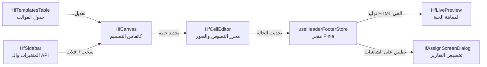

# توثيق وحدة محرر وإدارة الهيدر والفوتر (Header & Footer Builder)

توفر هذه الوحدة نظاماً متكاملاً واحترافياً لإنشاء وتصميم وإدارة قوالب **الهيدر (Header)** و **الفوتر (Footer)** للمطبوعات والتقارير والشاشات داخل النظام، مع دعم كامل للمتغيرات الديناميكية، إدراج الصور وتخصيصها بـ 12 قالباً بصرياً، وإدارة القوالب عبر جدول بيانات تفاعلي.

---

## 📁 هيكل المجلدات والملفات (Project Structure)

```text
src/headerandfooter/
├── HeaderFooterBuilder.vue            # المكون الرئيسي للوحدة (Main Container)
├── README.md                          # ملف التوثيق الشامل (هذا الملف)
│
├── components/                        # مكونات واجهة المستخدم (UI Components)
│   ├── HfTemplatesTable.vue           # جدول عرض وإدارة قوالب الهيدر والفوتر
│   ├── HfTopBar.vue                   # شريط التحكم العلوي وأزرار التنقل
│   ├── HfSidebar.vue                  # الشريط الجانبي للمتغيرات وإعدادات الأعمدة
│   ├── HfCanvas.vue                   # كانفاس التصميم وتوزيع الأعمدة والخلايا
│   ├── HfCellEditor.vue               # محرر الخلية الغني وأدوات تنسيق النصوص والصور
│   ├── HfLivePreview.vue              # شاشة المعاينة الحية للهيدر والفوتر
│   ├── HfCreateDialog.vue             # نافذة معالج إنشاء قالب جديد
│   ├── HfTemplateSelectDialog.vue     # نافذة اختيار ومعاينة قالب لشاشة معينة
│   ├── HfAssignScreenDialog.vue       # نافذة ربط وتخصيص القوالب بشاشات النظام
│   ├── HfEmptyState.vue               # العرض الافتراضي في حالة عدم وجود قالب
│   └── HfTutorialModal.vue            # نافذة التعليمات والإرشادات السريعة
│
├── stores/                            # إدارة الحالة (State Management - Pinia)
│   └── useHeaderFooterStore.js        # متجر إدارة القوالب وتوليد الـ HTML والمتغيرات
│
├── utils/                             # الدوال المساعدة والأدوات (Utility Functions)
│   └── chipUtils.js                   # دوال تحليل ومعالجة وسوم المتغيرات وتنسيقات الصور
│
├── constants/                         # الثوابت والقيم المشتركة (Constants)
│   └── index.js                       # ثوابت الخطوط، الأحجام، وأيقونات المحاذاة
│
└── styles/                            # ملفات الأنماط والتنسيقات (Stylesheets)
    └── headerFooter.css               # التنسيقات الموحدة للوحدة ودعم RTL والتجاوب
```

---

## 📄 الشرح التفصيلي لكافة الملفات

### 1. المكون الرئيسي (Root Component)

#### 🔹 `HeaderFooterBuilder.vue`
* **المسار**: `src/headerandfooter/HeaderFooterBuilder.vue`
* **الوظيفة**:
  - يعمل كحاوية رئيسية ومنسق بين كافة المكونات الفرعية.
  - يعرض **جدول القوالب (`HfTemplatesTable`)** كواجهة رئيسية مستقرة وأنيقة.
  - يفتح محرر التصميم والكانفاس والمعاينة الحية بالكامل داخل **ديالوق شامل ومريح (`v-dialog`)** عند النقر على إضافة قالب جديد أو تعديل أي قالب.
  - يتولى معالجة أحداث الإنشاء، الحذف، التكرار (Duplicate)، وتعديل القوالب.

---

### 2. مجلد المكونات (`components/`)

#### 🔹 `HfTemplatesTable.vue`
* **الوظيفة**:
  - يعرض كافة قوالب الهيدر والفوتر في **جدول بيانات أنيق وتفاعلي**.
  - يحتوي على شريط أدوات علوي مع حقل بحث فوري، عداد القوالب، وزر إنشاء قالب جديد.
  - يعرض لكل قالب: اسم القالب، معرفه، عدد أعمدة الهيدر مع مؤشر لونه، عدد أعمدة الفوتر مع مؤشر لونه، وحالة القالب النشط.
  - يوفر إجراءات سريعة:
    - ✏️ **تعديل**: فتح محرر التصميم مباشرة داخل ديالوق مخصص.
    - 👁️ **معاينة سريعة**: نافذة منبثقة لمعاينة شكل الهيدر والفوتر بدون مغادرة الجدول.
    - 📋 **نسخ وتكرار**: مضاعفة القالب لإنشاء قالب جديد مشتق منه.
    - 🗑️ **حذف**: حذف القالب مع نافذة تأكيد.

#### 🔹 `HfTopBar.vue`
* **الوظيفة**:
  - شريط العنوان العلوي الثابت للوحدة.
  - يحتوي على شعار وعنوان ووصف المحرر.
  - يوفر أزرار الإجراءات السريعة: زر "قالب جديد" وزر "تخصيص للشاشات".
  - يوفر أزرار الإجراءات الرئيسية: "تخصيص للشاشات" و "قالب جديد".

#### 🔹 `HfSidebar.vue`
* **الوظيفة**:
  - اللوحة الجانبية اليمنى التي تحتوي على:
    1. **تبويب المتغيرات الثابتة (Static Variables)**: مثل التاريخ، الوقت، اسم الشركة، عنوان الصفحة، الصور والشعارات.
    2. **تبويب متغيرات الـ API (Dynamic Variables)**: يتم جلبها تلقائياً من الخادم مع إمكانية التحديث اليدوي.
    3. **إعدادات الأعمدة والمظهر**: التحكم بعدد أعمدة الهيدر أو الفوتر (1 إلى 5 أعمدة)، ألوان الخلفية والحدود والارتفاع.
  - يدعم إدراج المتغيرات بالنقر المباشر أو عبر السحب والإفلات (Drag & Drop).

#### 🔹 `HfCanvas.vue`
* **الوظيفة**:
  - يمثل منطقة العمل التفاعلية (Canvas) لعرض شبكة أعمدة الهيدر والفوتر.
  - يتيح النقر على أي خلية لتحديدها وتفعيل محررها.
  - يستقبل المتغيرات المسحوبة من الشريط الجانبي ويسقطها مباشرة في الخلية الهدف.
  - يعرض وسوم المتغيرات (Chips) داخل الخلايا مع إمكانية حذفها بضغطة زر.

#### 🔹 `HfCellEditor.vue`
* **الوظيفة**:
  - شريط الأدوات ومحرر المحتوى المتقدم للخلية المحددة.
  - **تنسيق النصوص**: اختيار نوع الخط (Cairo, Tajawal, Amiri, Roboto...)، حجم الخط، المحاذاة (يمين، وسط، يسار)، الغامق، المائل، التسطير، ولون النص وخلفية الخلية.
  - **التحكم المتقدم بالصور والشعارات**:
    - **قوالب وأشكال الصور (12 شكلاً)**: دائري، افتراضي، بطاقة، سويركل (Squircle)، شارة، إطار ذهبي، حبة (Pill)، توهج نيون، بولارويد، ختم وزاري مزدوج، ظل ثلاثي الأبعاد، وزجاجي (Glass).
    - **شفافية الصورة (Opacity)**: سلايدر مع أزرار سريعة (100%، 85%، 60%، 30%).
    - **ملاءمة الصورة (Object-Fit)**: احتواء (Contain)، تغطية (Cover)، تمدد (Fill)، بدون تحجيم (None)، تقليص متناسب (Scale-Down).
    - **أبعاد الصورة (Width & Height)**: حقول إدخال رقمية مع زر قفل تناسب الأبعاد (Lock Ratio).
    - **شاشة معاينة مثبتة (Pinned Preview)**: نافذة معاينة فورية في أعلى الحوار تظل ثابتة أثناء التمرير في الخيارات.

#### 🔹 `HfLivePreview.vue`
* **الوظيفة**:
  - يقدم محاكاة حية كاملة لورقة التقرير A4 مطبوعة.
  - يعرض الهيدر في الأعلى، ومحتوى وهمي للتقرير في المنتصف، والفوتر في الأسفل.
  - يتفاعل لحظياً مع أي تعديل في الكانفاس أو المحرر.
  - يقع داخل منطقة التمرير الموحدة في الصفحة لسهولة الرؤية.

#### 🔹 `HfCreateDialog.vue`
* **الوظيفة**:
  - نافذة معالج إنشاء قالب جديد (Step Wizard).
  - الخطوة 1: تحديد اسم القالب.
  - الخطوة 2: اختيار عدد أعمدة الهيدر وعدد أعمدة الفوتر بشكل مرئي وسريع.

#### 🔹 `HfTemplateSelectDialog.vue`
* **الوظيفة**:
  - مكون قابل لإعادة الاستخدام في أي شاشة خارجية في النظام.
  - يتيح للمستخدم البحث عن قالب وتحديده مع عرض معاينة حية للهيدر والفوتر قبل التأكيد.

#### 🔹 `HfAssignScreenDialog.vue`
* **الوظيفة**:
  - نافذة مخصصة لربط قوالب الهيدر والفوتر بشاشات وتقارير النظام المختلفة (مثل: فاتورة المبيعات، كشف الحساب، سند القبض، تقرير المخزون...).
  - يحفظ الارتباطات في التخزين المحلي (`localStorage`) لاسترجاعها عند طباعة أي تقرير.

#### 🔹 `HfEmptyState.vue`
* **الوظيفة**:
  - يظهر عند عدم وجود قوالب في النظام، لتوجيه المستخدم لإنشاء أول قالب هيدر وفوتر.

#### 🔹 `HfTutorialModal.vue`
* **الوظيفة**:
  - حوار إرشادي لشرح كيفية استخدام المحرر والسحب والإفلات وإدراج المتغيرات.

---

### 3. مجلد إدارة الحالة (`stores/`)

#### 🔹 `useHeaderFooterStore.js`
* **المسار**: `src/headerandfooter/stores/useHeaderFooterStore.js`
* **الوظيفة الرئيسية**:
  - إدارة حالة القوالب (`templates`) والقالب النشط (`activeTemplateId`).
  - جلب المتغيرات البيئية الديناميكية من الـ API (`common/environment-variables-r/all/`) مع التبديل التلقائي للبيانات الاحتياطية في حال تعذر الاتصال.
  - توليد كود الـ HTML النقي والنهائي للطباعة (`generateHTMLForTemplate` و `generateHTML`) مع استبدال المتغيرات بقيمها الحقيقية وتطبيق كافة تنسيقات الصور والنصوص.
  - دوال إدارة القوالب: `createTemplate`, `duplicateTemplate`, `deleteTemplate`, `setActiveTemplate`, `setHeaderColumns`, `setFooterColumns`, `updateCellContent`, `updateCellStyle`, `updateSectionStyle`.

---

### 4. مجلد الأدوات المساعدة (`utils/`)

#### 🔹 `chipUtils.js`
* **المسار**: `src/headerandfooter/utils/chipUtils.js`
* **الوظيفة الرئيسية**:
  - تحليل وسوم المتغيرات داخل الخلايا مثل: `{{organizationLogo|120|60|stamp-double|85|cover}}`.
  - استخراج وتشفير معايير الصور (العرض، الارتفاع، القالب، الشفافية، الـ Object-Fit).
  - توفير كود CSS و SVG للـ 12 قالباً بجماليات حديثة.
  - دوال مساعدة لإنشاء وإزالة وتحديث الوسوم في نصوص الخلايا.

---

### 5. مجلد الثوابت (`constants/`)

#### 🔹 `index.js`
* **المسار**: `src/headerandfooter/constants/index.js`
* **الوظيفة الرئيسية**:
  - `FONTS`: قائمة الخطوط المدعومة (Cairo, Tajawal, Almarai, Alexandria, Amiri, Roboto, Arial, Tahoma...).
  - `FONT_SIZES`: المقاسات المتاحة للخطوط (من 8px إلى 64px).
  - `ALIGN_ICONS`: أيقونات محاذاة النص لمكتبة Material Design Icons.

---

### 6. مجلد التنسيقات (`styles/`)

#### 🔹 `headerFooter.css`
* **المسار**: `src/headerandfooter/styles/headerFooter.css`
* **الوظيفة الرئيسية**:
  - ملف CSS موحد يحتوي على كافة التصاميم الجمالية للمحرر.
  - يدعم اتجاه الواجهة من اليمين لليسار (RTL) والألوان المتناسقة مع ثيم Vuetify.
  - يحتوي على تنسيقات قوالب الصور الـ 12، بطاقات الكانفاس، شريط الأدوات العائم، جدول القوالب، والتجاوب مع الشاشات الصغيرة (Mobile Responsive).

---

## 🔄 دورة حياة وسير العمل (Workflow)



---

## 💡 كيفية الاستخدام والتضمين في الشاشات والتقارير

### 1. عرض محرر الهيدر والفوتر بالكامل في شاشة مستقلة:
```vue
<template>
  <HeaderFooterBuilder />
</template>

<script setup>
import HeaderFooterBuilder from '@/headerandfooter/HeaderFooterBuilder.vue'
</script>
```

### 2. استخدام نافذة اختيار قالب لشاشة أو تقرير معين:
```vue
<template>
  <div>
    <v-btn @click="showSelectDialog = true">اختيار ترويسة التقرير</v-btn>

    <HfTemplateSelectDialog
      v-model="showSelectDialog"
      @confirm="onTemplateChosen"
    />
  </div>
</template>

<script setup>
import { ref } from 'vue'
import HfTemplateSelectDialog from '@/headerandfooter/components/HfTemplateSelectDialog.vue'

const showSelectDialog = ref(false)

const onTemplateChosen = ({ templateId, template, html }) => {
  console.log('القالب المختار:', template.name)
  console.log('كود الهيدر:', html.header)
  console.log('كود الفوتر:', html.footer)
}
</script>
```
